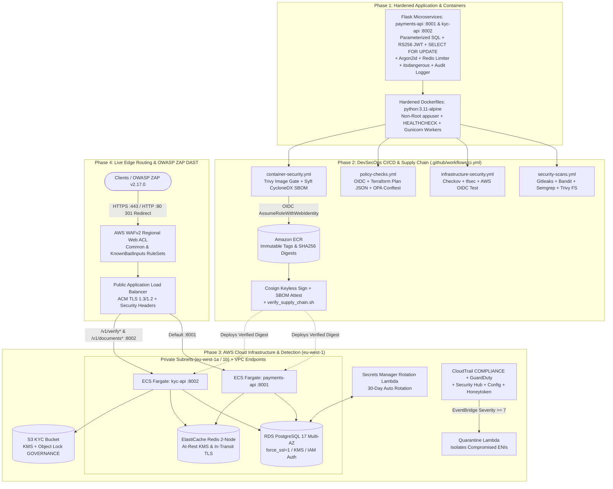

# SentinelPay: Securing a Pan-African Payments Platform on AWS[cite: 1, 2, 3, 4, 5, 6, 7]

%20%7C%20ECS%20Fargate%20%7C%20Terraform-FF9900?style=flat-square)

> **Executive Summary:** SentinelPay Technologies Ltd is a pan-African fintech platform processing card and bank-transfer payments for ~1,400 merchants across Nigeria, Ghana, Kenya, and Rwanda[cite: 1]. Following an external disclosure of a production Insecure Direct Object Reference (IDOR) vulnerability, our five-person security engineering team executed a comprehensive, four-phase security transformation across the application, CI/CD pipeline, cloud infrastructure, and runtime edge layers[cite: 1, 2, 3, 4, 5, 6, 7]. We remediated all 11 application vulnerability classes (`V-APP-01` through `V-APP-11`) and hardened the microservice containers (`payments-api` and `kyc-api`)[cite: 1, 2, 7], built a fail-closed GitHub Actions DevSecOps pipeline with keyless AWS OIDC authentication, OPA/Conftest policy-as-code, Syft CycloneDX SBOMs, and Cosign container signing[cite: 1, 3, 4, 5, 6], provisioned a private-by-default Multi-AZ AWS architecture in `eu-west-1` via modular Terraform[cite: 1, 3, 5], and verified the live deployment with OWASP ZAP (`v2.17.0`) Dynamic Application Security Testing (DAST)[cite: 2, 7].

---

## Table of Contents
- [1. Problem Statement & Objectives](#1-problem-statement--objectives)
- [2. Architecture & Design Overview](#2-architecture--design-overview)
- [3. Technology Stack & Tooling](#3-technology-stack--tooling)
- [4. Full Documentation Index](#4-full-documentation-index)
- [5. Four-Phase Implementation Walkthrough](#5-four-phase-implementation-walkthrough)
- [6. Validation, Testing & Proof of Work](#6-validation-testing--proof-of-work)
- [7. Key Challenges & Trade-Offs](#7-key-challenges--trade-offs)
- [8. Future Enhancements](#8-future-enhancements)

---

## 1. Problem Statement & Objectives

### Background & Risk / Bottleneck
After two years of rapid feature delivery without dedicated security engineering, an external researcher disclosed a production IDOR vulnerability[cite: 1, 2, 7]. A full-stack security audit uncovered critical exposures across four operational layers[cite: 1, 2, 3, 4, 5, 6, 7]:
* **Phase 1 Risk — Application & Container Vulnerabilities:** Automated static scanning (`Semgrep`, `Gitleaks`, `Bandit`) surfaced **36 Critical**, **3 High**, **20 Medium**, and **5 Low** findings[cite: 2, 7]. Manual code review confirmed active exposure to SQL Injection (`V-APP-01`), forgeable `alg: none` JWTs (`V-APP-02`), horizontal IDOR (`V-APP-03`), SSRF (`V-APP-04`), wallet double-spend race conditions (`V-APP-05`), weak MD5 password hashes (`V-APP-06`), mass assignment (`V-APP-07`), unthrottled auth endpoints (`V-APP-08`), verbose stack traces (`V-APP-09`), `pickle` Remote Code Execution (`V-APP-10`), missing compliance audit logs (`V-APP-11`), and root-privileged Docker containers running the development Werkzeug server[cite: 1, 2, 7].
* **Phase 2 Risk — Unverified CI/CD & Software Supply Chain:** Uncontrolled pushes to `main`, fragmented CI logic, static cloud access keys, lack of executable infrastructure policy, mutable container tags, and unsigned images allowed vulnerable code and unverified artifacts to progress toward deployment[cite: 3, 4, 5, 6].
* **Phase 3 Risk — Cloud Configuration Drift & Detection Blind Spots:** Ad-hoc cloud provisioning risked public exposure of compute and database tiers, unencrypted data stores and logs, unrotated database credentials, and the absence of centralized threat detection or automated containment[cite: 1, 3, 5].
* **Phase 4 Risk — Runtime Edge & Transport Exposure:** Live container deployments required public ALB path-based routing, NAT Gateway egress tuning, TLS 1.3/1.2 termination, HTTP-to-HTTPS redirection, separated HTTP exception boundaries, and defensive browser security headers to withstand active DAST probing[cite: 2, 7].

### Core Objectives
* **Objective 1 (Phase 1 — AppSec Code Remediation & Container Hardening):** Remediate and exploit-verify all 11 application vulnerabilities (`V-APP-01` to `V-APP-11`) across `payments-api` (`:8001`) and `kyc-api` (`:8002`), and refactor Dockerfiles to minimal `python:3.11-alpine` images running as non-root `appuser` with Gunicorn workers and native `HEALTHCHECK` probes[cite: 1, 2, 7].
* **Objective 2 (Phase 2 — DevSecOps CI/CD, Policy as Code & Supply Chain):** Protect `main` via pull-request governance, orchestrate four reusable GitHub Actions workflows (`ci.yml`), replace static AWS keys with short-lived GitHub OIDC credentials, enforce OPA/Conftest Rego policies against Terraform plans, and bind Syft CycloneDX SBOMs and keyless Cosign signatures to immutable Amazon ECR image digests[cite: 1, 3, 4, 5, 6].
* **Objective 3 (Phase 3 — Cloud Security & Modular Terraform Infrastructure):** Provision a modular AWS platform in `eu-west-1` with S3/DynamoDB remote state locking, Multi-AZ public/private subnets, VPC endpoints, customer-managed KMS encryption, 30-day Secrets Manager rotation, S3 Object Lock, CloudTrail, GuardDuty, Security Hub, AWS Config, an IAM honeytoken, and automated high-severity ENI quarantine[cite: 1, 3, 5].
* **Objective 4 (Phase 4 — Live Cloud Deployment & OWASP ZAP DAST Remediation):** Deploy the hardened containers to AWS ECS Fargate behind an AWS WAFv2-protected Application Load Balancer, execute passive and active OWASP ZAP (`v2.17.0`) scans, enable ACM HTTPS (`:443`) + HTTP `301` redirects, and inject defensive HTTP security headers[cite: 2, 7].

### Team Structure & Engineering Tracks

| Role | Owner | Track & Responsibilities |
| :--- | :--- | :--- |
| **Team Lead** | Tega | STRIDE threat modelling, PR review, 5-plane constraint verification, and attack-simulation coordination[cite: 1]. |
| **Lead AppSec Engineer** | Chinaza Nnamani | Vulnerability scanning (`security_scan.py`), Power BI triage dashboard, manual code review, `V-APP-01`–`V-APP-11` fixes, Alpine/Gunicorn container hardening, and live OWASP ZAP DAST remediation[cite: 1, 2, 7]. |
| **Cloud Engineer — Network & Compute** | Femi | Multi-AZ VPC, public/private subnet isolation, NAT, VPC endpoints, ECS Fargate, ALB, AWS WAFv2, and IAM roles[cite: 1, 3, 5]. |
| **Cloud Engineer — Data, Identity & Detection** | Ben / Sunday Abiodun | Customer-managed KMS, Multi-AZ RDS PostgreSQL, ElastiCache Redis, S3 Object Lock, Secrets Manager rotation, GuardDuty, CloudTrail, Security Hub, AWS Config, IAM honeytokens, and quarantine automation[cite: 1, 3, 5]. |
| **DevSecOps Engineer** | Mohammed / Muhammad Asif Salaudeen | Reusable GitHub Actions CI/CD architecture, GitHub-to-AWS OIDC federation, OPA/Conftest policy-as-code, Syft CycloneDX SBOMs, and Cosign keyless signing/verification[cite: 1, 4, 6]. |

---

## 2. Architecture & Design Overview

### Four-Phase End-to-End Architecture Diagram

### Key Design Decisions Across the Four Phases
1. **Phase 1 — Defense-in-Depth Application & Container Hardening:** Replaced string-interpolated SQL with `psycopg2` parameterized `%s` queries (`V-APP-01`), upgraded JWTs from symmetric `HS256` to asymmetric `RS256` (`V-APP-02`), enforced SQL/S3 caller ownership checks (`V-APP-03`), locked wallet rows during debits via `SELECT ... FOR UPDATE` (`V-APP-05`), and migrated containers to non-root `python:3.11-alpine` images running Gunicorn[cite: 1, 2, 7].
2. **Phase 2 — Reusable Fail-Closed CI/CD & Digest-Bound Supply Chain:** Separated CI orchestration (`ci.yml`) into four specialist reusable workflows with 5-minute timeouts, eliminated static AWS keys via GitHub OIDC (`sts:AssumeRoleWithWebIdentity`), enforced custom OPA Rego policies via Conftest (`--all-namespaces`), scanned both service images before enforcing the Trivy gate (`if: always()`), and bound Syft CycloneDX SBOMs and keyless Cosign signatures directly to immutable ECR `sha256` digests[cite: 1, 3, 4, 5, 6].
3. **Phase 3 — Private-by-Default Cloud Architecture & Automated Containment:** Isolated ECS Fargate, Multi-AZ RDS PostgreSQL 17, and ElastiCache Redis inside private subnets with security-group-reference-only ingress, customer-managed KMS encryption (with separated `kms-admin` and `kms-user` roles), 30-day signed Lambda secret rotation, S3 Object Lock (`COMPLIANCE` on CloudTrail; `GOVERNANCE` on KYC), an IAM honeytoken tripwire, and a GuardDuty (`severity >= 7`) Quarantine Lambda[cite: 1, 3, 5].
4. **Phase 4 — TLS 1.3/1.2 Edge Enforcement & DAST Response Hardening:** Configured path-based ALB routing (`:8001` default for `payments-api`; `/v1/verify*` and `/v1/documents*` to `:8002` for `kyc-api`), imported an X.509 certificate into AWS ACM for HTTPS (`:443`) + HTTP `301` redirects, separated `@app.errorhandler(HTTPException)` from `Exception` to stop `404` routes from returning `500`, and injected strict `@app.after_request` browser security and anti-caching headers[cite: 2, 7].

---

## 3. Technology Stack & Tooling

| Phase | Tool / Platform | Role in SentinelPay | Why It Was Chosen |
| :--- | :--- | :--- | :--- |
| **Phase 1: AppSec & Containers** | Python 3.11 (`alpine`), Flask, Gunicorn, `psycopg2`, `argon2-cffi`, `itsdangerous`, `Flask-Limiter`, Power BI | Core microservices (`:8001`, `:8002`), vulnerability triage, and runtime hardening[cite: 2, 7] | Enforces parameterized SQL, Argon2id hashing, signed sessions, Redis rate limiting, non-root execution, and deduplicated triage[cite: 2, 7]. |
| **Phase 2: DevSecOps & Supply Chain** | GitHub Actions, AWS OIDC, Gitleaks, Bandit, Semgrep, Trivy, Checkov, tfsec, OPA Conftest, Syft, Cosign | Automated PR security gates, policy-as-code, CycloneDX SBOMs, and keyless image signing[cite: 1, 3, 4, 5, 6] | Enforces fail-closed shift-left security, removes long-lived cloud keys, and verifies immutable ECR image provenance[cite: 3, 4, 5, 6]. |
| **Phase 3: Cloud & Detection** | AWS (`eu-west-1`), Terraform, VPC, ECS Fargate, RDS PostgreSQL 17, Redis, S3, KMS, Secrets Manager, CloudTrail, GuardDuty, Security Hub, Config, EventBridge, Lambda | Modular cloud infrastructure, envelope encryption, secret rotation, compliance, and ENI quarantine[cite: 1, 3, 5] | Eliminates configuration drift, isolates workloads in private subnets, and automates threat detection and response[cite: 1, 3, 5]. |
| **Phase 4: Edge & DAST** | AWS ALB, AWS WAFv2, AWS ACM, OpenSSL, OWASP ZAP (`v2.17.0`), `curl` | Public ingress filtering, TLS termination, and live dynamic security scanning[cite: 2, 7] | Validates live endpoints against injection, transport, and header weaknesses behind AWS WAFv2[cite: 2, 7]. |

---

## 4. Full Documentation Index

Browse the deep-dive engineering documentation in the [`/docs`](./docs) directory, where every guide is organized across the exact same four phases[cite: 1]:

| Document | Description |
| :--- | :--- |
| [**01. System Architecture & Security Controls**](./docs/architecture.md) | 4-phase architectural blueprint covering microservice routes (`V-APP-01`–`V-APP-11`), reusable CI/CD workflows & OPA Rego policies, the 10 Terraform cloud modules, and DAST edge routing[cite: 1, 2, 3, 4, 5, 6, 7]. |
| [**02. End-to-End Setup & Implementation Guide**](./docs/setup-guide.md) | 4-phase step-by-step implementation guide with exact commands and code snippets from AppSec remediation to CI/CD gating, Terraform provisioning, and OWASP ZAP DAST remediation[cite: 1, 2, 3, 4, 5, 6, 7]. |
| [**03. Runbook & Troubleshooting Guide**](./docs/troubleshooting.md) | 4-phase troubleshooting runbook detailing root causes and fixes for secret baselines, OIDC trust errors, Conftest namespaces, Checkov/tfsec findings, ECS `503` crash loops, and ZAP alerts[cite: 1, 2, 3, 4, 5, 6, 7]. |

---

## 5. Four-Phase Implementation Walkthrough

### Phase 1: Application Security (AppSec) Code Remediation & Container Hardening
1. **Mapping, Scanning & Power BI Triage:** Mapped all 20 routes across `payments-api` (`:8001`) and `kyc-api` (`:8002`), executed `security_scan.py` (`Semgrep`, `Bandit`, `Gitleaks`), and built a **Microsoft Power BI Vulnerability Dashboard** to deduplicate and prioritize the **36 Critical**, **3 High**, **20 Medium**, and **5 Low** findings across the codebase[cite: 2, 7].
2. **Critical Path Code Remediation (`V-APP-01` – `V-APP-11`):**
   * **`V-APP-01` (SQLi — Critical):** Replaced string interpolation with `psycopg2` parameterized `%s` queries in `/v1/transactions/search` and `/v1/verify/lookup`[cite: 1, 2, 7].
   * **`V-APP-02` (JWT — Critical):** Migrated from `HS256`/`alg: none` to asymmetric `RS256` (`JWT_PRIVATE_KEY` / `JWT_PUBLIC_KEY`) with 15-minute expiry and refresh-token rotation[cite: 1, 2, 7].
   * **`V-APP-03` (IDOR — High):** Enforced `WHERE id = %s AND user_id = %s` on account/wallet queries and restricted S3 KYC keys to `users/{user_id}/`[cite: 1, 2, 7].
   * **`V-APP-04` (SSRF — High):** Built `validate_callback_url` to enforce `HTTPS`, block private/loopback/link-local/metadata IPs, disable redirects (`allow_redirects=False`), and hardcode BVN provider URLs[cite: 2, 7].
   * **`V-APP-05` (Race Condition — Critical):** Wrapped wallet debits in a transaction block with PostgreSQL `SELECT ... FOR UPDATE` row-level locking[cite: 2, 7].
   * **`V-APP-06` (Hashing — High):** Upgraded from `hashlib.md5()` to `Argon2id` (`argon2-cffi`) with transparent login-time migration for legacy MD5 hashes[cite: 2, 7].
   * **`V-APP-07` (Mass Assignment — High):** Whitelisted only `account_number` and `currency` on `PUT /v1/accounts/<account_id>/profile`[cite: 2, 7].
   * **`V-APP-08` (Rate Limiting — Medium):** Deployed Redis-backed `Flask-Limiter` (`5/minute`) keyed by IP and hashed canonical email/E.164 phone identifiers[cite: 2, 7].
   * **`V-APP-09` (Verbose Errors — Low):** Set `debug=False` and registered global error handlers returning sanitized JSON while logging tracebacks server-side[cite: 2, 7].
   * **`V-APP-10` (Deserialization — Critical):** Replaced `pickle.loads()` on `/v1/admin/session/restore` with `itsdangerous.URLSafeTimedSerializer`[cite: 2, 7].
   * **`V-APP-11` (Audit Logging — Medium):** Engineered the secret-masking `sentinelpay.audit` structured JSON logger for all wallet and KYC state changes[cite: 2, 7].
3. **Container Hardening (`Dockerfile`):** Refactored both Dockerfiles to `python:3.11-alpine`, upgraded OS packages (`apk update && apk upgrade --no-cache`), removed lock/backup files, enforced non-root `USER appuser`, added native `HEALTHCHECK` probes, and launched production **Gunicorn** workers[cite: 2, 7].

### Phase 2: DevSecOps CI/CD Pipeline, Policy as Code & Supply-Chain Security
1. **Repository Governance & Reusable Workflows:** Protected `main` with PR review and status-check requirements and refactored `.github/workflows/ci.yml` to orchestrate four domain-specific reusable workflows (`security-scans.yml`, `infrastructure-security.yml`, `container-security.yml`, and `policy-checks.yml`) with 5-minute fail-closed timeouts[cite: 3, 4, 5, 6].
2. **Keyless AWS OIDC Federation:** Configured GitHub Actions to assume `arn:aws:iam::105045466108:role/sentinelpay-dev-github-actions` via `token.actions.githubusercontent.com` (`sts:AssumeRoleWithWebIdentity`) locked to the repository's `main` and `pull_request` subjects[cite: 1, 3, 4, 5, 6].
3. **Executable Policy as Code (`OPA / Conftest`):** Authored four Rego policy packages (`s3_public.rego`, `network_ingress.rego`, `encryption.rego`, `iam_wildcard.rego`), validated them against paired fixtures in `policy-tests/`, and wired `policy-checks.yml` to evaluate live Terraform plan JSON from `infra/environments/dev` using `--all-namespaces`[cite: 1, 3, 4, 5, 6].
4. **Combined Trivy Image Gate, Syft SBOMs & Cosign Provenance:** Configured `container-security.yml` to scan both `payments-api` and `kyc-api` images before enforcing a combined `if: always()` CRITICAL gate, generate CycloneDX SBOMs (`payments-sbom.cdx.json`, `kyc-sbom.cdx.json`) with **Syft**, push to immutable **Amazon ECR** repositories, resolve `@sha256` digests, sign and attest both digests keylessly with **Cosign**, and verify provenance via `verify_supply_chain.sh`[cite: 4, 6].

### Phase 3: Cloud Security & Modular Terraform Infrastructure Provisioning (`eu-west-1`)
1. **Encrypted Remote State Bootstrap (`Bootstrap/`):** Provisioned a versioned, encrypted S3 state bucket (`sentinelpay-terraform-state-*`, `prevent_destroy = true`) and a DynamoDB lock table (`sentinelpay-terraform-locks`) with KMS server-side encryption and 35-day Point-in-Time Recovery (PITR)[cite: 1, 3, 5].
2. **Multi-AZ Network, Edge & Compute (`network`, `edge`, `compute`):** Provisioned a custom VPC across `eu-west-1a/1b` with 2 public subnets, 2 private subnets (`map_public_ip_on_launch = false`), NAT Gateways, VPC Endpoints (S3, ECR, Secrets Manager, KMS, CloudWatch), an empty `default-deny` default security group, 365-day KMS-encrypted VPC Flow Logs, an ECS Fargate cluster with `ContainerInsights` enabled, and an ALB protected by AWS WAFv2 (`CommonRuleSet` & `KnownBadInputsRuleSet`)[cite: 1, 3, 5].
3. **Encrypted Data Stores & 30-Day Secret Rotation (`kms`, `rds`, `data`, `secrets-rotation`):** Created a customer-managed KMS key (`enable_key_rotation = true`) with separated `kms-admin` and `kms-user` roles[cite: 1, 3, 5]. Deployed Multi-AZ RDS PostgreSQL 17 (`rds.force_ssl = 1`, IAM auth, Enhanced Monitoring), a 2-node ElastiCache Redis replication group (at-rest KMS + in-transit TLS + AUTH token), an S3 KYC bucket with Object Lock (`GOVERNANCE`, 90 days), and a code-signed Python 3.13 Lambda rotating PostgreSQL credentials every 30 days[cite: 1, 3, 5].
4. **Threat Detection, Compliance & Automated Quarantine (`detection`, `identity-center`):** Enabled multi-region CloudTrail (S3 Object Lock `COMPLIANCE` for 365 days, KMS, SNS notifications), GuardDuty (S3, EBS malware, RDS login, Lambda network monitoring), Security Hub (**FSBP v1.0.0** & **CIS v5.0.0**), and an AWS Config **CIS v1.4 Level 2 Conformance Pack**[cite: 1, 3, 5]. Deployed an unprivileged IAM Honeytoken (`sentinelpay-dev-honeytoken`) wired to EventBridge and a Quarantine Lambda (`sentinelpay-dev-quarantine`) that isolates compromised ENIs on GuardDuty findings with `severity >= 7`[cite: 1, 3, 5].

### Phase 4: Live Container Deployment, OWASP ZAP DAST Execution & Remediation
1. **ECS Fargate Stabilization (Fixing `503 Service Temporarily Unavailable`):** Configured public ALB path-based routing (`:8001` default for `payments-api`; `/v1/verify*` and `/v1/documents*` to `:8002` for `kyc-api`), updated `alb_to_ecs` security group egress to allow ports `8001–8002`, opened `ecs_https` egress (`0.0.0.0/0` on `:443`) for NAT Gateway access to ECR and CloudWatch, and injected runtime `env_vars` into the ECS task definitions to bring `/health` to `200 OK`[cite: 2, 7].
2. **OWASP ZAP (`v2.17.0`) Baseline & Active Scanning:** Executed `zap-baseline.py` and `zap-full-scan.py` against `http://sentinelpay-dev-alb-2097557956.eu-west-1.elb.amazonaws.com`, confirming **0 High-severity vulnerabilities** while identifying 9 Medium/Low/Informational transport, error-handling, and header findings[cite: 2, 7].
3. **Full DAST Remediation:**
   * **ACM TLS 1.3/1.2 & HTTP `301` Redirect (Fixes Plugin `10106`):** Generated a 2048-bit RSA X.509 certificate via OpenSSL, imported it into AWS ACM (`eu-west-1`), provisioned `aws_lb_listener.https` (`:443`), and sequenced removal of `http_forward` via `depends_on` to enforce `HTTP_301` redirects on port `80`[cite: 2, 7].
   * **HTTP Exception Boundary (Fixes Plugins `90022` & `10023`):** Registered `@app.errorhandler(HTTPException)` before `@app.errorhandler(Exception)` in both services so unmapped routes (`/`, `/robots.txt`, `/sitemap.xml`) return clean `404 Not Found` (`{"error": "resource not found"}`) instead of `500 Internal Server Error`, and updated the 500 fallback message to `"request could not be processed"`[cite: 2, 7].
   * **Defensive Security Headers & Banner Suppression (Fixes Plugins `10038`, `10063`, `10021`, `90004`, `10049` & `10036`):** Switched Dockerfiles to **Gunicorn** and added an `@app.after_request` hook injecting `Content-Security-Policy`, `X-Content-Type-Options: nosniff`, `Cross-Origin-Resource-Policy: same-origin`, `Permissions-Policy`, `Cache-Control: no-store, no-cache, must-revalidate, private`, `Pragma: no-cache`, `Expires: 0`, and `Server: SentinelPay`[cite: 2, 7].

---

## 6. Validation, Testing & Proof of Work

### Four-Phase Baseline vs. Post-Implementation Results

| Phase | Metric / Security Control | Baseline (Before) | Post-Implementation (After) | Status |
| :--- | :--- | :--- | :--- | :--- |
| **Phase 1: AppSec** | **Application Vulnerabilities (`V-APP-01`–`V-APP-11`)** | 36 Critical, 3 High, 20 Medium, 5 Low (SQLi, `alg: none` JWT, IDOR, SSRF, TOCTOU Race, MD5, Mass Assignment, RCE)[cite: 2, 7] | **0 Critical, 0 High**; parameterized SQL, `RS256` JWT, `SELECT ... FOR UPDATE`, `Argon2id`, `itsdangerous`, Redis rate limit, & JSON audit logs verified[cite: 2, 7] | Passed[cite: 2, 7] |
| **Phase 1: Containers** | **Dockerfile & Runtime Hardening** | Root `python:3.11` base image running Werkzeug dev server (`python -m app.main`) without health checks[cite: 2, 7] | Minimal `python:3.11-alpine`, non-root `USER appuser`, native `HEALTHCHECK`, and production **Gunicorn** workers[cite: 2, 7] | Passed[cite: 2, 7] |
| **Phase 2: CI/CD** | **Pull-Request Security Gates (`ci.yml`)** | Failing SAST/Secret/SCA/Container scans and failing `sts:AssumeRoleWithWebIdentity` OIDC[cite: 2, 3, 4, 5, 6, 7] | **All 10 CI jobs passing** (`test-workflow`, `Gitleaks`, `Bandit`, `Semgrep`, `Trivy FS`, `Checkov`, `tfsec`, `Trivy Image`, `AWS OIDC`, `OPA Conftest`)[cite: 2, 3, 4, 5, 6, 7] | Passed[cite: 2, 3, 4, 5, 6, 7] |
| **Phase 2: Supply Chain** | **Artifact Provenance (`Syft` + `Cosign` + `ECR`)** | Mutable tags with no SBOMs, no signatures, and no pre-deployment verification[cite: 4, 6] | Immutable ECR tags resolved to `@sha256` digests, CycloneDX SBOMs attested, and keyless Cosign signatures verified via `verify_supply_chain.sh`[cite: 4, 6] | Passed[cite: 4, 6] |
| **Phase 3: CloudSec** | **Terraform IaC Security (`Checkov` & `tfsec`)** | Unencrypted logs, `<1 yr` retention, missing CloudTrail SNS, open HTTP, missing SG descriptions[cite: 3, 5] | **`tfsec`: 207 passed, 0 Critical/High/Medium/Low**; Checkov controls passed; 365-day KMS logs, Multi-AZ RDS/Redis, S3 Object Lock, & VPC Endpoints active[cite: 1, 3, 5] | Passed[cite: 3, 5] |
| **Phase 3: Detection** | **Cloud Audit, Honeytoken & Auto-Quarantine** | No centralized cloud audit trail, deception tripwires, or automated containment[cite: 1, 3, 5] | Multi-region CloudTrail + GuardDuty + Security Hub (CIS/FSBP) + Config + IAM Honeytoken + EventBridge Severity `>= 7` Quarantine Lambda active[cite: 1, 3, 5] | Passed[cite: 1, 3, 5] |
| **Phase 4: DAST** | **OWASP ZAP Live ALB Scan (`v2.17.0`)** | 0 High, 2 Medium (HTTP-only `10106`, missing CSP `10038`), 6 Low (`500` on `404` routes, `Werkzeug` banner, missing headers)[cite: 2, 7] | **0 High, 0 Medium, 0 Low**; ACM TLS 1.3/1.2 (`:443`), HTTP `301` redirect, Gunicorn + `Server: SentinelPay`, and full security headers verified[cite: 2, 7] | Passed[cite: 2, 7] |

### Visual Evidence Gallery

#### Phase 1 Proof: JWT `alg: none` Blocked (`V-APP-02`), IDOR Blocked (`V-APP-03`), Deserialization Blocked (`V-APP-10`) & Audit Logging (`V-APP-11`)

*Figure 1: Empirical before-and-after verification confirming rejection of forged `alg: none` JWTs (`401 UNAUTHORIZED`), enforcement of cross-account IDOR ownership checks (`404 NOT FOUND`), blocking of untrusted `pickle` session blobs (`401 UNAUTHORIZED`), and structured `sentinelpay.audit` JSON logging[cite: 1, 2, 7].*

#### Phase 2, 3 & 4 Proof: Terraform State Bootstrap, ECR Container Promotion & Live DAST HTTPS Header Verification

*Figure 2: Provisioning the encrypted S3/DynamoDB remote state backend, pushing hardened Alpine microservice images to Amazon ECR (`eu-west-1`), and verifying live HTTPS TLS termination, Gunicorn execution, defensive browser headers, and clean `404` JSON responses on the AWS ALB[cite: 1, 2, 7].*

---

## 7. Key Challenges & Trade-Offs

* **Phase 1 Challenge — Zero-Downtime Password Hashing Migration & Secret Baselines:** Upgrading `users.password_hash` from unsalted MD5 to `Argon2id` risked locking out existing merchants, while historical training secrets and Terraform honeytoken references triggered Gitleaks[cite: 1, 2, 7]. We built a transparent login-time MD5-to-Argon2id re-hashing flow and baselined historical/honeytoken fingerprints in `gitleaks-baseline.json` so CI blocks only net-new leaks[cite: 1, 2, 4, 6, 7].
* **Phase 2 Challenge — GitHub OIDC Subject Mismatches, Conftest Working Directory & Immutable ECR Tags:** Initial OIDC role assumption failed after 12 retries due to a customized GitHub repository subject format, `policy-checks.yml` failed with `No configuration files` when run from `infra/`, and workflow re-runs collided with immutable ECR commit tags[cite: 3, 4, 5, 6]. We aligned the IAM trust policy in `modules/github-oidc` to allow both `main` and `pull_request` subjects, pointed Conftest at `infra/environments/dev` with `--all-namespaces` and OIDC backend auth, and resolved `@sha256` digests for Cosign signing while keeping ECR tag immutability intact[cite: 1, 3, 4, 5, 6].
* **Phase 3 Challenge — AWS Sandbox Quotas & Checkov/tfsec Hardening:** Setting `reserved_concurrent_executions = 5` on the rotation Lambda triggered AWS account minimum-unreserved-capacity errors, and KMS key policies initially restricted CloudWatch Logs encryption to `/ecs/*`[cite: 1, 2, 3, 5, 7]. We tuned concurrency for sandbox limits, expanded regional log group KMS conditions, and remediated 11 Checkov/`tfsec` findings to achieve **207 passed `tfsec` checks with 0 failures**[cite: 1, 2, 3, 5, 7].
* **Phase 4 Challenge — ECS `503` Crash Loops, ALB `DuplicateListener` Conflicts & ZAP `500` Error Disclosures:** Initial requests to the public ALB returned `503` because ECS tasks lacked NAT Gateway `:443` egress and `env_vars` injection; switching port `80` from `http_forward` to `http` redirect caused a `DuplicateListener` conflict; and `@app.errorhandler(Exception)` caught Werkzeug `404` exceptions during ZAP scans[cite: 2, 7]. We opened `:443` egress, injected `env_vars`, sequenced listener replacement via `depends_on`, and registered `@app.errorhandler(HTTPException)` before `Exception`[cite: 2, 7].

---

## 8. Future Enhancements

- [ ] **Complete Cycle 6 & 7 Ephemeral PR Environments and Timed Attack Simulations (MTTD/MTTR):** Spin up isolated per-PR staging environments for automated OWASP ZAP gating before teardown, and execute timed attack simulations (honeytoken credential leak, vulnerable dependency injection, and manual IaC drift) to benchmark Mean Time to Detect (MTTD) and Mean Time to Respond (MTTR)[cite: 1, 4, 6].
- [ ] **Separate PR Validation & Main Deployment IAM Roles + Stricter Cosign Identity:** Split the GitHub OIDC role into a read/plan-only PR role and a main-branch deployment role[cite: 3, 5], and pin Cosign verification to the exact GitHub workflow certificate identity in `verify_supply_chain.sh`[cite: 4, 6].
- [ ] **Cross-Region S3 Replication & Centralized SARIF Reporting:** Enable S3 Cross-Region Replication (`CKV_AWS_144`) on CloudTrail and KYC buckets for production disaster recovery[cite: 1, 3, 5], and aggregate Gitleaks, SAST, SCA, IaC, and Conftest outputs into GitHub Security SARIF dashboards[cite: 4, 6].

---

## Authors & Project Contributors

* **Chinaza Nnamani** — Lead Application Security Engineer (`AppSec`, Container Hardening & `OWASP ZAP DAST`)[cite: 1, 2, 7]
* **Sunday Abiodun (Ben)** — Cloud Security & DevSecOps Engineer (`KMS`, `RDS`, `Redis`, `S3`, `Secrets Rotation`, `Detection` & `OIDC`)[cite: 1, 3, 5]
* **Muhammad Asif Salaudeen (Mohammed)** — DevSecOps Engineer (`Reusable CI/CD Workflows`, `OPA/Conftest`, `Syft SBOM` & `Cosign Supply-Chain Security`)[cite: 1, 4, 6]
* **Femi Agbi** — Cloud Engineer (`VPC Network`, `ECS Fargate`, `ALB`, `WAFv2` & `IAM`)[cite: 1]
* **Tega** — Team Lead (`STRIDE Threat Modelling`, `PR Governance` & `Constraint Verification`)[cite: 1]