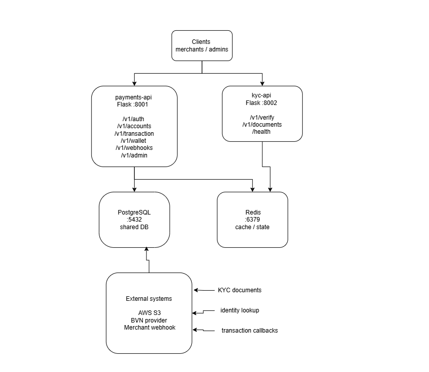
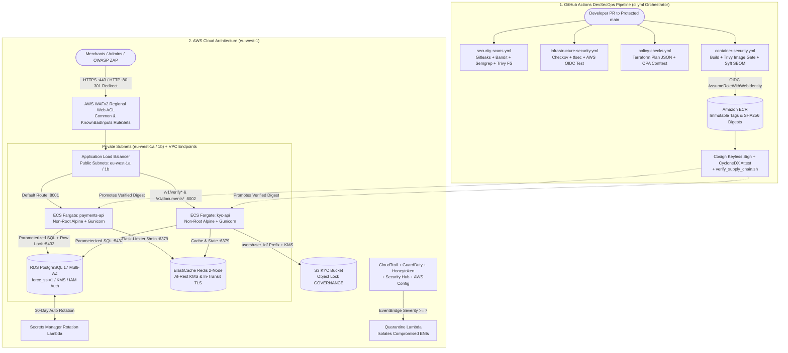

# SentinelPay: Securing a Pan-African Payments Platform on AWS


%20%7C%20ECS%20Fargate%20%7C%20Terraform-FF9900?style=flat-square)


> **Executive Summary:** SentinelPay Technologies Ltd is a pan-African fintech platform processing card and bank-transfer payments for ~1,400 merchants across Nigeria, Ghana, Kenya, and Rwanda. Following an external disclosure of a production Insecure Direct Object Reference (IDOR) vulnerability, our five-person security engineering team executed a multi-cycle remediation and architectural overhaul across the application, cloud infrastructure, and CI/CD delivery layers. We eliminated 100% of Critical and High application vulnerabilities across the `payments-api` and `kyc-api` Flask microservices, replaced ad-hoc cloud setup with a modular, private-by-default AWS Terraform architecture in `eu-west-1`, established a fail-closed GitHub Actions DevSecOps pipeline using keyless AWS OIDC federation, OPA/Conftest policy-as-code, Syft CycloneDX SBOMs, and Cosign container signing, and verified the live deployment with OWASP ZAP Dynamic Application Security Testing (DAST).

---

## Table of Contents
- [1. Problem Statement & Objectives](#1-problem-statement--objectives)
- [2. Architecture & Design Overview](#2-architecture--design-overview)
- [3. Technology Stack & Tooling](#3-technology-stack--tooling)
- [4. Full Documentation Index](#4-full-documentation-index)
- [5. Implementation Walkthrough](#5-implementation-walkthrough)
- [6. Validation, Testing & Proof of Work](#6-validation-testing--proof-of-work)
- [7. Key Challenges & Trade-Offs](#7-key-challenges--trade-offs)
- [8. Future Enhancements](#8-future-enhancements)

---

## 1. Problem Statement & Objectives

### Background & Risk / Bottleneck
After two years of rapid feature delivery without dedicated security investment, an external researcher disclosed an IDOR vulnerability in production. A comprehensive audit across the codebase, cloud environment, and delivery workflow revealed systemic risks across three domains:
* **Application Layer Exposure:** Static scanning (`Semgrep`, `Bandit`, `Gitleaks`) and manual line-by-line review uncovered **36 Critical**, **3 High**, **20 Medium**, and **5 Low** findings, including SQL Injection (`V-APP-01`), forgeable `alg: none` JWTs (`V-APP-02`), horizontal IDOR (`V-APP-03`), SSRF (`V-APP-04`), wallet-debit TOCTOU race conditions (`V-APP-05`), weak MD5 password hashes (`V-APP-06`), mass assignment (`V-APP-07`), missing auth rate limits (`V-APP-08`), verbose stack traces (`V-APP-09`), `pickle` Remote Code Execution (`V-APP-10`), and missing compliance audit logs (`V-APP-11`).
* **Cloud & Infrastructure Drift:** Manual cloud provisioning risked configuration drift, public exposure of compute/database tiers, unencrypted data stores, static credentials, and blind spots in threat detection.
* **Unverified Delivery & Supply Chain:** Uncontrolled pushes to `main`, fragmented CI checks, long-lived cloud credentials in CI/CD, lack of executable infrastructure policy, and unsigned container artifacts created severe software-supply-chain exposure.

### Core Objectives
* **Objective 1 (Application Security & Container Hardening):** Remediate all 11 application vulnerabilities (`V-APP-01` through `V-APP-11`) with before/after exploit verification, migrate containers to non-root `python:3.11-alpine` images running Gunicorn, and validate the live AWS deployment with OWASP ZAP DAST scans.
* **Objective 2 (Defense-in-Depth Cloud Architecture):** Provision a modular Terraform platform in AWS (`eu-west-1`) with S3/DynamoDB remote state locking, Multi-AZ public/private network isolation, VPC endpoints, customer-managed KMS encryption, 30-day Secrets Manager rotation, immutable S3 Object Lock, GuardDuty/Security Hub/Config/CloudTrail telemetry, an IAM honeytoken, and automated high-severity ENI quarantine.
* **Objective 3 (Reusable DevSecOps Pipeline & Supply-Chain Provenance):** Enforce branch protection on `main`, orchestrate four domain-specific reusable GitHub Actions workflows, authenticate to AWS via short-lived OIDC tokens, gate changes with Gitleaks/Bandit/Semgrep/Trivy/Checkov/tfsec/OPA Conftest, and bind CycloneDX SBOMs and keyless Cosign signatures to immutable Amazon ECR image digests.

### Team Structure & Engineering Tracks

| Role | Owner | Track & Responsibilities |
| :--- | :--- | :--- |
| **Team Lead** | Tega | STRIDE threat modelling, PR review, 5-plane constraint verification, and attack-simulation coordination. |
| **Lead AppSec Engineer** | Chinaza Nnamani | Vulnerability scanning (`security_scan.py`), Power BI triage dashboard, manual code review, `V-APP-01`–`V-APP-11` fixes, Alpine/Gunicorn container hardening, and live OWASP ZAP DAST remediation. |
| **Cloud Engineer — Network & Compute** | Femi | Multi-AZ VPC, public/private subnet isolation, NAT, VPC endpoints, ECS Fargate, ALB, AWS WAFv2, and IAM roles. |
| **Cloud Engineer — Data, Identity & Detection** | Ben / Sunday Abiodun | Customer-managed KMS, Multi-AZ RDS PostgreSQL, ElastiCache Redis, S3 Object Lock, Secrets Manager rotation, GuardDuty, CloudTrail, Security Hub, AWS Config, IAM honeytokens, and quarantine automation. |
| **DevSecOps Engineer** | Mohammed / Muhammad Asif Salaudeen | Reusable GitHub Actions CI/CD architecture, GitHub-to-AWS OIDC federation, OPA/Conftest policy-as-code, Syft CycloneDX SBOMs, and Cosign keyless signing/verification. |

---

## 2. Architecture & Design Overview



### End-to-End DevSecOps & Cloud Runtime Workflow



### Key Design Decisions
1. **Separation of CI Orchestration from Specialist Reusable Workflows:** Rather than maintaining a brittle monolithic workflow, a central `.github/workflows/ci.yml` orchestrates four domain-specific reusable workflows (`security-scans.yml`, `infrastructure-security.yml`, `container-security.yml`, and `policy-checks.yml`) with 5-minute fail-closed timeouts and combined multi-image Trivy gates that scan both services before enforcing failures.
2. **Keyless Cloud Federation & Digest-Bound Supply-Chain Provenance:** Long-lived AWS keys were eliminated using GitHub OIDC (`sts:AssumeRoleWithWebIdentity`) with strict repository and branch/PR subject conditions. Validated images pushed to immutable Amazon ECR repositories are resolved to `sha256` digests, signed keylessly via Sigstore Cosign, attached with Syft CycloneDX SBOM attestations, and cryptographically verified before deployment.
3. **Zero-Trust Application & Multi-Tier Cloud Isolation:** In the Flask layer, `RS256` asymmetric JWTs, `Argon2id` hashing, parameterized queries, `SELECT ... FOR UPDATE` row locking, and strict `user_id` ownership checks eliminate the OWASP Top 10 attack surface. In AWS, ECS Fargate tasks, Multi-AZ RDS PostgreSQL 17, and ElastiCache Redis run in private subnets without public IPs, accepting traffic solely via security-group references from the WAFv2-protected ALB and rotation Lambda.

---

## 3. Technology Stack & Tooling

| Category | Tool / Platform | Role in This Project | Why It Was Chosen |
| :--- | :--- | :--- | :--- |
| **Application & Runtime** | Python 3.11 (Alpine), Flask, Gunicorn, `psycopg2`, `argon2-cffi`, `itsdangerous`, `Flask-Limiter` | Core `payments-api` (`:8001`) and `kyc-api` (`:8002`) microservices | Parameterized SQL, Argon2id password hashing, signed session serialization, non-root execution, and Redis rate limiting. |
| **Cloud Infrastructure** | AWS (`eu-west-1`), VPC, ECS Fargate, ALB, WAFv2, RDS PostgreSQL 17, ElastiCache Redis, S3, KMS, Secrets Manager, ACM | Multi-AZ compute, encrypted storage, edge filtering, and automated 30-day secret rotation | Eliminates host SSH management, enforces envelope encryption at rest and TLS in transit, and isolates data tiers. |
| **Detection & Governance** | CloudTrail, GuardDuty, Security Hub, AWS Config, EventBridge, Lambda (Python 3.13), IAM Identity Center | Continuous compliance (CIS & FSBP), honeytoken tripwires, and automated ENI quarantine | Tamper-resistant audit trails (S3 Object Lock) and sub-minute automated containment of high-severity (`>= 7`) threats. |
| **IaC & Policy as Code** | Terraform (`Bootstrap/` + `infra/`), Open Policy Agent (OPA / Rego), Conftest, Checkov, tfsec | Declarative cloud provisioning and pre-deployment plan validation | Prevents configuration drift and blocks public S3 buckets, wildcard IAM policies, unencrypted storage, and open ingress. |
| **DevSecOps & Supply Chain** | GitHub Actions, AWS OIDC, Gitleaks, Bandit, Semgrep, Trivy, Syft, Cosign / Sigstore | Shift-left CI/CD gating, CycloneDX SBOM generation, and keyless container signing/verification | Enforces fail-closed PR checks, removes static AWS keys, and binds verifiable provenance to immutable ECR digests. |
| **DAST & Analytics** | OWASP ZAP (`v2.17.0`), Microsoft Power BI, OpenSSL, `curl` | Vulnerability deduplication/prioritization and live dynamic security scanning | Accelerates triage across 64 static detections and empirically verifies live HTTPS and security header controls. |

---

## 4. Full Documentation Index

For deep-dive technical specifics across all three tracks, browse the dedicated documentation modules in the [`/docs`](./docs) directory:

| Document | Description |
| :--- | :--- |
| [**01. System Architecture & Security Controls**](./docs/architecture.md) | Comprehensive breakdown of the Flask microservice routes, `V-APP-01`–`V-APP-11` remediations, the 10 Terraform infrastructure modules, the 4 reusable GitHub Actions workflows, OPA Rego policies, and GuardDuty/Honeytoken detection architecture. |
| [**02. Step-by-Step Setup & Deployment Guide**](./docs/setup-guide.md) | End-to-end instructions for bootstrapping S3/DynamoDB remote state, deploying the `eu-west-1` Terraform environment, configuring GitHub OIDC, building/signing ECR containers with Syft & Cosign, and running OWASP ZAP DAST scans. |
| [**03. Runbook & Troubleshooting Guide**](./docs/troubleshooting.md) | Root-cause analysis and fixes for GitHub OIDC trust mismatches, Conftest working-directory & namespace issues, ECR immutable tag collisions, Checkov/Lambda concurrency errors, ECS `503` crash loops, and ZAP DAST findings. |

---

## 5. Implementation Walkthrough

### Track 1: Application Security Remediation & Container Hardening (Cycles 1–3)
We mapped all 20 endpoints across `payments-api` (`:8001`) and `kyc-api` (`:8002`), executed `security_scan.py` (`Semgrep`, `Bandit`, `Gitleaks`), and built a **Microsoft Power BI dashboard** to triage the 64 findings (**36 Critical, 3 High, 20 Medium, 5 Low**). Every route was manually reviewed and penetration-tested before and after remediation:
* **SQLi, JWT, IDOR & SSRF (`V-APP-01` to `V-APP-04`):** Replaced string interpolation with parameterized `psycopg2` `%s` queries (`V-APP-01`); migrated JWTs from `HS256`/`alg: none` to asymmetric `RS256` with 15-minute expiry (`V-APP-02`); enforced `WHERE id = %s AND user_id = %s` and S3 `users/{user_id}/` ownership checks (`V-APP-03`); and implemented `validate_callback_url` to block non-HTTPS and private/metadata IPs with `allow_redirects=False` (`V-APP-04`).
* **Concurrency, Hashing, Mass Assignment & Rate Limiting (`V-APP-05` to `V-APP-08`):** Locked wallet rows during debits via PostgreSQL `SELECT ... FOR UPDATE` (`V-APP-05`); upgraded password hashes from MD5 to `Argon2id` with transparent login-time migration (`V-APP-06`); whitelisted only `account_number` and `currency` on profile updates (`V-APP-07`); and enforced `5/minute` Redis `Flask-Limiter` rules keyed on normalized email/E.164 phone hashes (`V-APP-08`).
* **Error Handling, Deserialization, Audit Logging & Dockerfiles (`V-APP-09` to `V-APP-11`):** Set `debug=False` with custom `HTTPException`/`Exception` handlers (`V-APP-09`); replaced `pickle.loads()` with `itsdangerous.URLSafeTimedSerializer` (`V-APP-10`); built the secret-masking `sentinelpay.audit` JSON logger (`V-APP-11`); and refactored both Dockerfiles to `python:3.11-alpine` with non-root `USER appuser`, native `HEALTHCHECK`, and production **Gunicorn** workers.

### Track 2: Cloud Security & Modular Terraform Infrastructure (Cycles 3–5)
We engineered a modular Terraform platform rooted at `infra/environments/dev` backed by an encrypted S3 state bucket and DynamoDB locking table (`Bootstrap/`) with KMS encryption and 35-day Point-in-Time Recovery (PITR):
* **Segmented Multi-AZ Network & Edge (`network`, `edge`, `compute`):** Provisioned a custom VPC across `eu-west-1a` and `eu-west-1b` with 2 public subnets, 2 private subnets (`map_public_ip_on_launch = false`), NAT Gateways, VPC Endpoints (S3, ECR, Secrets Manager, KMS, CloudWatch), 365-day KMS-encrypted VPC Flow Logs, an empty default security group (`default-deny`), ECS Fargate with `ContainerInsights`, and an ALB protected by AWS WAFv2 (`CommonRuleSet` & `KnownBadInputsRuleSet`).
* **Data Protection, KMS & Secret Rotation (`kms`, `rds`, `data`, `secrets-rotation`):** Configured a customer-managed KMS key (`enable_key_rotation = true`) separating `kms-admin` and `kms-user` roles. Deployed Multi-AZ RDS PostgreSQL 17 (`rds.force_ssl = 1`, IAM auth, Enhanced Monitoring), a 2-node ElastiCache Redis cluster (TLS + KMS at rest + AUTH token), an S3 KYC bucket with Object Lock (`GOVERNANCE`), and a code-signed Python 3.13 Lambda rotating PostgreSQL credentials every 30 days.
* **Continuous Detection & Automated Containment (`detection`, `identity-center`):** Enabled multi-region CloudTrail (S3 Object Lock `COMPLIANCE`, KMS, SNS notifications), GuardDuty (S3, EBS malware, RDS login, Lambda network monitoring), Security Hub (FSBP v1.0.0 & CIS v5.0.0), and an AWS Config CIS v1.4 Level 2 Conformance Pack. Planted an IAM honeytoken (`sentinelpay-dev-honeytoken`) monitored by EventBridge and wired high-severity (`>= 7`) GuardDuty findings to a Quarantine Lambda (`sentinelpay-dev-quarantine`) that isolates compromised ENIs.

### Track 3: DevSecOps CI/CD Pipeline, Policy as Code & Supply Chain (Cycles 1–5)
We protected the `main` branch and refactored CI into `.github/workflows/ci.yml` orchestrating four reusable workflows:

<details>
<summary><strong>Click to expand: Combined Trivy Image Gate & OPA Rego Policy Enforcement</strong></summary>

In `container-security.yml`, both `payments-api` and `kyc-api` images are scanned before the `if: always()` gate evaluates outcomes so a failure in the first image never hides vulnerabilities in the second:

```yaml
- name: Enforce Trivy image security gate
  if: always()
  run: |
    if [ "${{ steps.trivy_payments.outcome }}" = "failure" ] || \
       [ "${{ steps.trivy_kyc.outcome }}" = "failure" ]; then
      echo "Trivy scan failed or CRITICAL vulnerabilities detected in one or more SentinelPay images."
      exit 1
    fi
    echo "No CRITICAL vulnerabilities detected."
```

In `policy-checks.yml`, Terraform plans generated in `infra/environments/dev` are converted to JSON and evaluated by **Conftest** (`--all-namespaces`) against four OPA Rego packages (`policy/terraform/s3_public.rego`, `network_ingress.rego`, `encryption.rego`, and `iam_wildcard.rego`).

</details>

* **Keyless AWS OIDC & Artifact Provenance:** GitHub Actions assumes `arn:aws:iam::105045466108:role/sentinelpay-dev-github-actions` via `token.actions.githubusercontent.com`, generates CycloneDX SBOMs (`payments-sbom.cdx.json`, `kyc-sbom.cdx.json`) with **Syft**, pushes images to immutable **Amazon ECR** repositories, resolves `sha256` digests, signs and attests both digests keylessly with **Cosign**, and verifies signatures and transparency-log claims via `verify_supply_chain.sh`.

### Track 4: Live Cloud Deployment & OWASP ZAP DAST Remediation
After deploying the containers to ECS Fargate behind the public ALB (`sentinelpay-dev-alb-2097557956.eu-west-1.elb.amazonaws.com`) and resolving initial `503` networking/environment issues, we executed passive (`zap-baseline.py`) and active (`zap-full-scan.py`) **OWASP ZAP (`v2.17.0`)** scans. Both scans confirmed **0 High-severity vulnerabilities**, and all 9 Medium/Low/Informational alerts were remediated by importing an X.509 certificate into AWS ACM for HTTPS (`:443`) + HTTP `301` redirects, separating `@app.errorhandler(HTTPException)` from `Exception` to stop `404` routes from returning `500`, switching to Gunicorn, and injecting `Content-Security-Policy`, `X-Content-Type-Options: nosniff`, `Cross-Origin-Resource-Policy: same-origin`, `Permissions-Policy`, `Cache-Control: no-store`, and `Server: SentinelPay` headers.

---

## 6. Validation, Testing & Proof of Work

### Multi-Track Results Against Success Metrics

| Track | Metric / Control | Baseline (Before) | Post-Implementation (After) | Status |
| :--- | :--- | :--- | :--- | :--- |
| **AppSec** | **Critical & High App Vulnerabilities (`V-APP-01`–`V-APP-11`)** | 36 Critical, 3 High, 20 Medium, 5 Low across SQLi, JWT `alg: none`, IDOR, SSRF, TOCTOU Race, MD5, Mass Assignment, RCE | **0 Critical, 0 High**; parameterized SQL, `RS256` JWT, `SELECT ... FOR UPDATE` lock, `Argon2id`, `itsdangerous`, Redis rate limit, & JSON audit logs verified | Passed |
| **AppSec / DAST** | **OWASP ZAP Live ALB Scan (`v2.17.0`)** | 0 High, 2 Medium (HTTP-only, no CSP), 6 Low (500 on 404 routes, `Werkzeug` banner, missing headers) | **0 High, 0 Medium, 0 Low**; ACM TLS 1.3/1.2 (`:443`), HTTP `301` redirect, Gunicorn + `Server: SentinelPay`, and full security headers verified | Passed |
| **CloudSec** | **Terraform IaC Security (`Checkov` & `tfsec`)** | Unencrypted logs, `<1 yr` retention, missing CloudTrail SNS, open HTTP, missing SG descriptions | **`tfsec`: 207 passed, 0 Critical/High/Medium/Low**; Checkov controls passed; 365-day KMS logs, Multi-AZ RDS/Redis, S3 Object Lock, & VPC Endpoints active | Passed |
| **CloudSec** | **Threat Detection & Automated Response** | No centralized cloud audit trail or automated containment | Multi-region CloudTrail + GuardDuty + Security Hub (CIS/FSBP) + Config + IAM Honeytoken + EventBridge Severity `>= 7` Quarantine Lambda active | Passed |
| **DevSecOps** | **Pull-Request CI/CD Security Gates (`ci.yml`)** | Failing SAST/Secret/SCA/Container jobs and broken `sts:AssumeRoleWithWebIdentity` OIDC | **All 10 CI jobs passing** (`Gitleaks`, `Bandit`, `Semgrep`, `Trivy FS`, `Checkov`, `tfsec`, `Trivy Image`, `AWS OIDC`, `OPA Conftest`) | Passed |
| **Supply Chain** | **Container Provenance (`Syft` + `Cosign` + `ECR`)** | Root `python:3.11` images with mutable tags, no SBOMs, and no cryptographic signatures | Non-root `python:3.11-alpine` images pushed to immutable ECR, resolved by `sha256` digest, attested with CycloneDX SBOMs, and verified via Cosign | Passed |

### Visual Evidence

#### 1. Application Security Remediation Proof (`V-APP-02` JWT, `V-APP-03` IDOR, `V-APP-10` Deserialization & `V-APP-11` Audit Logs)


*Figure 1: Empirical before-and-after verification confirming rejection of forged `alg: none` JWTs (`401 UNAUTHORIZED`), enforcement of cross-account IDOR ownership checks (`404 NOT FOUND`), blocking of untrusted `pickle` session blobs (`401 UNAUTHORIZED`), and structured `sentinelpay.audit` JSON logging.*

#### 2. Cloud Infrastructure Bootstrap, ECR Promotion & Live DAST Header Verification


*Figure 2: Provisioning the S3/DynamoDB remote state backend, pushing hardened Alpine microservice images to Amazon ECR (`eu-west-1`), and verifying live HTTPS TLS termination, Gunicorn execution, defensive browser headers, and clean `404` JSON responses on the AWS ALB.*

---

## 7. Key Challenges & Trade-Offs

> [!NOTE]
> Throughout the project, failing pipeline jobs and deployment errors were treated as engineering evidence rather than bypassed—shaping our automation around strict security controls.

* **Challenge 1: GitHub OIDC `AssumeRoleWithWebIdentity` Subject Mismatch & ECR Authorization**
  * *Issue:* Initial CI runs failed after 12 retries with `Could not assume role with OIDC: Not authorized to perform sts:AssumeRoleWithWebIdentity` because the AWS IAM trust policy did not match GitHub's customized immutable repository subject format; later, image promotion hit `ecr:DescribeImages` `AccessDenied` errors.
  * *Resolution:* Updated `infra/modules/github-oidc/main.tf` to allow both `repo:sentinelpay-team@321830913/Sentinelpay@1348603997:ref:refs/heads/main` and `:pull_request` subjects, removed the workflow condition skipping OIDC tests on PRs, and added `ecr:DescribeImages` and `ecr:DescribeRepositories` to the deployment policy.
* **Challenge 2: Immutable ECR Tags vs. Workflow Re-Runs & Multi-Image Scan Masking**
  * *Issue:* Rerunning a workflow for the same Git commit failed when pushing the same commit SHA tag because Amazon ECR tag immutability was enabled; additionally, failing immediately on the first vulnerable container image hid scan evidence for the second image.
  * *Resolution:* Retained ECR tag immutability as a core security control and updated `container-security.yml` to resolve `sha256` image digests for Cosign signing and CycloneDX SBOM attestation, while using an `if: always()` gate after both Trivy image scans so full telemetry is always captured.
* **Challenge 3: Resolving ECS Fargate `503 Service Temporarily Unavailable` & ZAP `500` Error Disclosures**
  * *Issue:* Initial requests to the live ALB returned `503` because ECS tasks lacked `0.0.0.0/0` port 443 egress through the NAT Gateway to reach ECR/CloudWatch and lacked injected `environment` variables; subsequently, OWASP ZAP active scans triggered `500 Internal Server Error` (`Plugins 90022 & 10023`) on `/robots.txt` because `@app.errorhandler(Exception)` caught Werkzeug `404` `HTTPException` subclasses.
  * *Resolution:* Updated `ecs_https` egress and wired `env_vars` into the ECS task definition to stabilize the containers, registered `@app.errorhandler(HTTPException)` before `Exception` to preserve `404`/`405` codes, imported an ACM TLS certificate (`:443` + `:80` `HTTP_301` redirect), and added `@app.after_request` security headers.

---

## 8. Future Enhancements

- [ ] **Complete Cycle 6 & 7 Ephemeral PR Environments and Timed Attack Simulations (MTTD/MTTR):** Spin up isolated per-PR staging environments for automated OWASP ZAP gating before teardown, and execute timed attack simulations (honeytoken credential leak, vulnerable dependency injection, and manual IaC drift) to benchmark MTTD and MTTR.
- [ ] **Separate PR Validation & Main Deployment IAM Roles + Stricter Cosign Identity:** Split the GitHub OIDC role into a read/plan-only PR role and a main-branch deployment role, and pin Cosign verification to the exact GitHub workflow certificate identity in `verify_supply_chain.sh`.
- [ ] **Cross-Region S3 Replication & Centralized SARIF Reporting:** Enable S3 Cross-Region Replication (`CKV_AWS_144`) on CloudTrail and KYC buckets for production disaster recovery, and aggregate Gitleaks, SAST, SCA, IaC, and Conftest outputs into GitHub Security SARIF dashboards.

---

## Authors & Project Contributors

* **Chinaza Nnamani** — Lead Application Security Engineer (`AppSec`, Container Hardening & `OWASP ZAP DAST`)
* **Sunday Abiodun (Ben)** — Cloud Security & DevSecOps Engineer (`KMS`, `RDS`, `Redis`, `S3`, `Secrets Rotation`, `Detection` & `OIDC`)
* **Muhammad Asif Salaudeen (Mohammed)** — DevSecOps Engineer (`Reusable CI/CD Workflows`, `OPA/Conftest`, `Syft SBOM` & `Cosign Supply-Chain Security`)
* **Femi Agbi** — Cloud Engineer (`VPC Network`, `ECS Fargate`, `ALB`, `WAFv2` & `IAM`)
* **Tega** — Team Lead (`STRIDE Threat Modelling`, `PR Governance` & `Constraint Verification`)