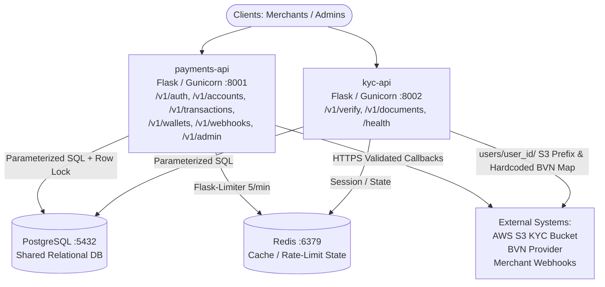
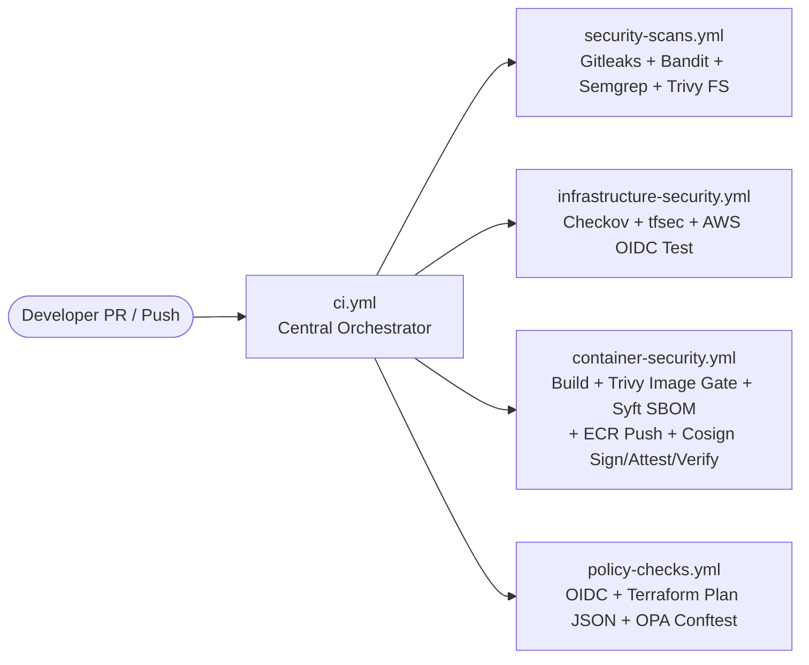
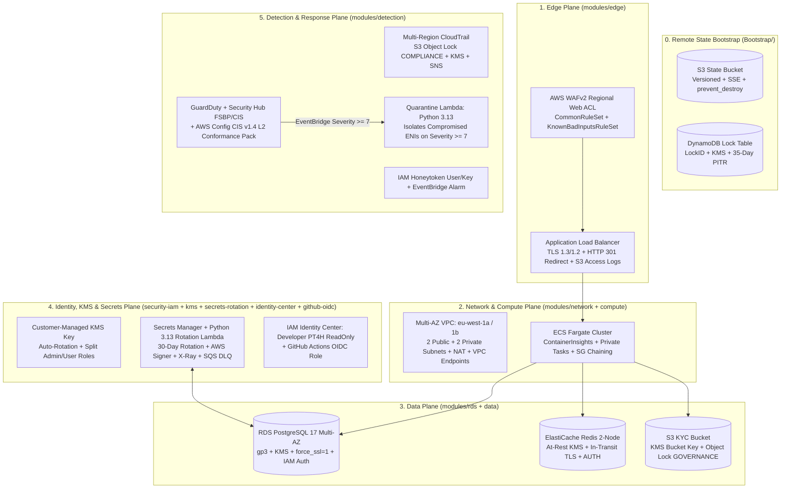

# SentinelPay: System Architecture & Security Controls

[← Back to Main Overview](../README.md)

> **Scope:** This document provides the complete architectural blueprint of the SentinelPay platform across all four implementation phases:
> 1. **Phase 1 — Application Security (AppSec) & Container Runtime Architecture** (`payments-api`, `kyc-api`, `V-APP-01`–`V-APP-11` controls, and hardened Alpine/Gunicorn containers)
> 2. **Phase 2 — DevSecOps CI/CD, Policy as Code & Supply-Chain Architecture** (Reusable GitHub Actions workflows, keyless AWS OIDC federation, OPA/Conftest Rego policies, Syft CycloneDX SBOMs, and Cosign provenance)
> 3. **Phase 3 — Cloud Security & Modular Terraform Architecture (`eu-west-1`)** (S3/DynamoDB state locking, Multi-AZ VPC segmentation, ECS Fargate, RDS PostgreSQL 17, ElastiCache Redis, S3 Object Lock, KMS, Secrets Rotation, and GuardDuty/CloudTrail/Honeytoken detection)
> 4. **Phase 4 — Live Edge Routing, DAST & HTTP Response Hardening Architecture** (Public ALB path-based routing, AWS WAFv2, ACM TLS 1.3/1.2 termination, exception boundaries, and defensive HTTP headers)

---

## Table of Contents
- [1. Phase 1: Application Security (AppSec) & Container Runtime Architecture](#1-phase-1-application-security-appsec--container-runtime-architecture)
- [2. Phase 2: DevSecOps CI/CD, Policy as Code & Supply-Chain Architecture](#2-phase-2-devsecops-cicd-policy-as-code--supply-chain-architecture)
- [3. Phase 3: Cloud Security & Modular Terraform Architecture (`eu-west-1`)](#3-phase-3-cloud-security--modular-terraform-architecture-eu-west-1)
- [4. Phase 4: Live Edge Routing, DAST & HTTP Response Hardening Architecture](#4-phase-4-live-edge-routing-dast--http-response-hardening-architecture)

---

## 1. Phase 1: Application Security (AppSec) & Container Runtime Architecture

### 1.1 Microservice Topology & Trust Boundaries
SentinelPay's application layer consists of two Python 3.11 Flask microservices—**`payments-api` (`:8001`)** and **`kyc-api` (`:8002`)**—communicating with a shared **PostgreSQL (`:5432`)** database and **Redis (`:6379`)** cache/rate-limiting store, alongside external integrations for **AWS S3** (KYC document storage), an external **BVN provider** (identity lookup), and **merchant webhooks** (transaction callbacks).

### 1.2 Endpoint Inventory & Vulnerability Mapping

#### `payments-api` Route Architecture (Port `8001`)

| Full Route | Method | Needs Auth | Money | KYC Data | Functional Role & Remediated Vulnerability Mapping |
| :--- | :--- | :--- | :--- | :--- | :--- |
| `/health` | `GET` | No | No | No | Unauthenticated container and ALB target group health check probe. |
| `/v1/auth/register` | `POST` | No | No | No | Creates merchant user in `users` table; hardened with **Argon2id** hashing (`V-APP-06`) and **Redis rate limiting** (`V-APP-08`). |
| `/v1/auth/login` | `POST` | No | No | No | Reads `id`, `password_hash`, `role`, `is_active` from `users`; issues **RS256 JWT** (`V-APP-02`), transparently migrates legacy MD5 hashes to **Argon2id** (`V-APP-06`), and enforces **5/min rate limits** (`V-APP-08`). |
| `/v1/auth/otp` | `POST` | No | No | No | Generates OTP; hardened with **Redis rate limiting** (`V-APP-08`) and **OTP log masking** (`V-APP-11`). |
| `/v1/accounts/<account_id>` | `GET` | Yes | Reads | No | Reads account balance, currency, status, and ownership; enforces `WHERE id = %s AND user_id = %s` (**`V-APP-03` IDOR**). |
| `/v1/accounts/` | `GET` | Yes | Reads | No | Lists all accounts and balances belonging to the authenticated caller. |
| `/v1/accounts/<account_id>/profile` | `PUT` | Yes | Can write | No | Updates account profile; strictly whitelists `account_number` and `currency` to block **`V-APP-07` Mass Assignment** of `balance`, `status`, or `user_id`. |
| `/v1/transactions/search` | `GET` | Yes | Reads | No | Searches transaction records (`amount`, `currency`, `direction`, `counterparty`, `description`); uses parameterized `%s` queries (**`V-APP-01` SQLi**). |
| `/v1/transactions/<reference>` | `GET` | Yes | Reads | No | Reads a specific transaction and its financial details by unique reference. |
| `/v1/wallets/<account_id>/credit` | `POST` | Yes | Writes | No | Credits account balance and inserts credit record; enforces ownership (**`V-APP-03`**) and structured **`sentinelpay.audit` logging** (**`V-APP-11`**). |
| `/v1/wallets/<account_id>/debit` | `POST` | Yes | Writes | No | Debits account balance; wrapped in a transaction with PostgreSQL `SELECT ... FOR UPDATE` row-level locking (**`V-APP-05` Race Condition**) and **`sentinelpay.audit` logging** (**`V-APP-11`**). |
| `/v1/webhooks/` | `POST` | Yes | No | No | Writes merchant webhook configuration (`user_id`, callback URL, event type) to PostgreSQL after URL validation (**`V-APP-04` SSRF**). |
| `/v1/webhooks/test` | `POST` | Yes | No | No | Fires test HTTP POST to webhook URL; enforces `validate_callback_url` (HTTPS only, blocks private/loopback/metadata IPs, `allow_redirects=False` — **`V-APP-04` SSRF**). |
| `/v1/admin/session/restore` | `POST` | Yes (Admin) | No | No | Restores admin session state; replaced `pickle.loads()` with `itsdangerous.URLSafeTimedSerializer` (**`V-APP-10` Insecure Deserialization / RCE**). |
| `/v1/admin/users` | `GET` | Yes (Admin) | No | No | Reads all rows from `users`; protected by asymmetric **RS256 JWT** verification and explicit `request.current_user_role == "admin"` checks (**`V-APP-02`**). |

#### `kyc-api` Route Architecture (Port `8002`)

| Full Route | Method | Needs Auth | Money | KYC Data | Functional Role & Remediated Vulnerability Mapping |
| :--- | :--- | :--- | :--- | :--- | :--- |
| `/health` | `GET` | No | No | No | Unauthenticated container and ALB target group health check probe. |
| `/v1/verify/bvn` | `POST` | Yes | No | Processes KYC ID | Submits BVN to external identity provider; hardcoded to a server-side provider URL configuration map (**`V-APP-04` SSRF**). |
| `/v1/verify/lookup` | `GET` | Yes | No | Reads KYC | Queries `kyc_records` by BVN or NIN; hardened with `psycopg2` parameterized `%s` queries (**`V-APP-01` SQLi**). |
| `/v1/documents/upload` | `POST` | Yes | No | Writes KYC | Uploads identity documents to the KMS-encrypted S3 KYC bucket under `users/{user_id}/`. |
| `/v1/documents/<path:key>` | `GET` | Yes | No | Reads KYC | Retrieves KYC documents from S3; enforces strict caller namespace ownership (`users/{user_id}/`) (**`V-APP-03` IDOR**). |

### 1.3 Static Vulnerability Analytics & Power BI Triage Architecture
During Phase 1, `security_scan.py` executed **Semgrep**, **Gitleaks**, and **Bandit** across the repository, feeding a custom **Microsoft Power BI Vulnerability Dashboard** to deduplicate and rank findings prior to manual code review:
* **Severity Distribution (64 Total Findings):** **36 Critical**, **3 High**, **20 Medium**, and **5 Low**.
* **Tool Detection Breakdown:** **Semgrep** (30 detections), **Gitleaks** (29 detections), and **Bandit** (13 detections).
* **Top 8 Most Vulnerable Files:** `docker-compose.yml`, `.github/workflows/ci.yml`, `scripts/legacy_deploy.sh`, `services/kyc-api/app/routes/documents.py`, `services/kyc-api/app/routes/verify.py`, `services/payments-api/tests/test_audit_logging.py`, `services/payments-api/app/auth.py`, and `services/payments-api/app/routes/admin.py`.
* **Top 6 Triggered Rules:** `sentinelpay-sensitive-env`, `yaml.github-actions.security.github-actions-mutable-action-tag`, `sentinelpay-terraform-secret`, `sentinelpay-database-url`, Bandit `B608` (SQL injection construction), and `aws-access-token`.

### 1.4 Defense-in-Depth Application Controls (`V-APP-01` – `V-APP-11`)

| Control ID | Vulnerability Class | Severity | Architectural Control & Implementation Mechanism |
| :--- | :--- | :--- | :--- |
| **`V-APP-01`** | **SQL Injection (SQLi)** | Critical | Replaced all `f-string` and `.format()` SQL concatenation in `transactions.py` and `verify.py` with `psycopg2` parameterized `%s` queries so inputs never alter SQL AST structure. |
| **`V-APP-02`** | **JWT Auth & Algorithm Confusion** | Critical | Migrated from symmetric `HS256` to asymmetric **`RS256`** (`JWT_PRIVATE_KEY` signs tokens in `payments-api`; `JWT_PUBLIC_KEY` verifies tokens across both services), explicitly rejecting `alg: none` and enforcing 15-minute expirations with refresh-token rotation. |
| **`V-APP-03`** | **Insecure Direct Object Reference (IDOR)** | High | Enforced data-layer ownership checks (`WHERE id = %s AND user_id = %s`) on account/wallet queries and restricted S3 KYC object keys to `users/{user_id}/`. |
| **`V-APP-04`** | **Server-Side Request Forgery (SSRF)** | High | Implemented `validate_callback_url()` enforcing `https://`, resolving DNS, and blocking private, loopback (`127.0.0.1`), link-local/IMDS (`169.254.169.254`), and multicast IPs with `allow_redirects=False`; locked BVN lookups to a server-side URL map. |
| **`V-APP-05`** | **TOCTOU Race Condition** | Critical | Wrapped wallet debits in an atomic database transaction with a PostgreSQL row-level lock (`SELECT ... FOR UPDATE`), serializing concurrent debit requests per wallet. |
| **`V-APP-06`** | **Weak Password Hashing** | High | Replaced `hashlib.md5()` with **`Argon2id`** (`argon2-cffi`, `$argon2id$v=19$m=65536,t=3,p=4`) and implemented transparent login-time re-hashing for existing MD5 records. |
| **`V-APP-07`** | **Mass Assignment** | High | Replaced dynamic JSON column binding on `PUT /v1/accounts/<account_id>/profile` with an explicit whitelist permitting only `account_number` and `currency`. |
| **`V-APP-08`** | **Missing Rate Limiting** | Medium | Deployed Redis-backed **`Flask-Limiter`** (`5/minute`) on `/v1/auth/login`, `/register`, and `/otp`, keyed by client IP and cryptographically hashed canonical email/E.164 phone identifiers. |
| **`V-APP-09`** | **Verbose Error Disclosure** | Low | Disabled `debug=True` and registered `@app.errorhandler(HTTPException)` + `@app.errorhandler(Exception)` to log full tracebacks server-side while returning sanitized JSON to clients. |
| **`V-APP-10`** | **Insecure Deserialization (RCE)** | Critical | Removed `pickle.loads()` from `/v1/admin/session/restore` and replaced it with `itsdangerous.URLSafeTimedSerializer` for signed, time-bound JSON session tokens. |
| **`V-APP-11`** | **Compliance Audit Logging** | Medium | Engineered `sentinelpay.audit` to emit structured JSON logs (`timestamp`, `event`, `actor_user_id`, `action`, `target`, `account_id`, `reference`, `amount`, `currency`, `ip`) with automatic secret/OTP masking. |

### 1.5 Container Runtime Hardening Architecture (`Dockerfile`)
Both `services/payments-api/Dockerfile` and `services/kyc-api/Dockerfile` enforce five container security controls:
1. **Minimal Base OS:** Migrated from `python:3.11` to `python:3.11-alpine` with `apk update && apk upgrade --no-cache`.
2. **Artifact Hygiene:** Purges residual `*.lock`, `*old.txt`, `*bak.txt`, `Pipfile*`, and `poetry*` files during build.
3. **Least-Privilege Non-Root Execution (`CK-02` & `IV-05`):** Creates a dedicated system group and user (`appuser:appgroup` with `/sbin/nologin`), transfers `/app` ownership, and enforces `USER appuser`.
4. **Native Health Probes:** Configures `HEALTHCHECK --interval=30s --timeout=10s --start-period=5s --retries=3` polling `http://localhost:8001/health` and `:8002/health`.
5. **Production WSGI Server:** Runs 2 **Gunicorn** worker processes (`gunicorn --bind 0.0.0.0:8001 --workers 2 app.main:create_app()`) instead of Werkzeug's single-threaded development server.

---

## 2. Phase 2: DevSecOps CI/CD, Policy as Code & Supply-Chain Architecture

### 2.1 Reusable GitHub Actions Orchestration Architecture
To avoid a brittle monolithic pipeline, SentinelPay separates workflow orchestration from specialist security domains under `.github/workflows/`. A protected `main` branch enforces pull-request reviews and required status checks before any code or Terraform change can merge.

| Workflow File | Security Domain | Integrated Tools & Enforcement Architecture |
| :--- | :--- | :--- |
| **`.github/workflows/ci.yml`** | **Central Coordinator** | Entry point triggered on `pull_request` and `push`; invokes the four specialist reusable workflows with 5-minute fail-closed timeouts. |
| **`security-scans.yml`** | **AppSec, Secrets & SCA** | Runs **Gitleaks** across full Git history (`.gitleaks.toml` + `gitleaks-baseline.json`), **Bandit** (blocks on High severity), **Semgrep** (`--error` blocks on ERROR findings), and **Trivy FS** (`.trivyignore`). |
| **`infrastructure-security.yml`** | **Static IaC & OIDC Identity** | Evaluates Terraform HCL with **Checkov** and **tfsec** (blocking on HIGH/CRITICAL) and validates live keyless role assumption via **Test AWS OIDC Authentication**. |
| **`container-security.yml`** | **Container & Supply Chain** | Builds `payments-api` and `kyc-api` images, scans both with **Trivy** before enforcing a combined `if: always()` CRITICAL gate, generates **Syft** CycloneDX SBOMs (`payments-sbom.cdx.json`, `kyc-sbom.cdx.json`), pushes to immutable **Amazon ECR**, resolves `sha256` digests, signs and attests keylessly with **Cosign**, and verifies provenance via `verify_supply_chain.sh`. |
| **`policy-checks.yml`** | **Executable Policy as Code** | Assumes the AWS OIDC role to initialize the S3 remote backend in `infra/environments/dev`, generates a real Terraform plan JSON, and evaluates all Rego namespaces (`--all-namespaces`) with **OPA / Conftest**. |

### 2.2 Policy as Code Architecture (`policy/terraform/` & `policy-tests/`)
Cycle 4 encoded SentinelPay's cloud security baseline into four Open Policy Agent (OPA) Rego v1 packages evaluated by Conftest against both paired JSON unit-test fixtures (`policy-tests/*/secure.json` and `insecure.json`) and live Terraform plan JSON:

| Rego Policy File | Package Namespace | Enforced Architectural Invariant |
| :--- | :--- | :--- |
| **`policy/terraform/s3_public.rego`** | `package terraform.s3` | Denies any `aws_s3_bucket` with a `public-read`, `public-read-write`, or `authenticated-read` ACL, and denies any `aws_s3_bucket_public_access_block` unless all four public-access block flags are `true`. |
| **`policy/terraform/network_ingress.rego`** | `package terraform.network` | Denies any `aws_security_group_rule` with `type == "ingress"` and `0.0.0.0/0` CIDR unless `from_port == 443`, `to_port == 443`, and `protocol == "tcp"` (the approved ALB HTTPS exception). |
| **`policy/terraform/encryption.rego`** | `package terraform.encryption` | Denies any `aws_db_instance` (`storage_encrypted != true`), `aws_ebs_volume` (`encrypted != true`), `aws_dynamodb_table` (`server_side_encryption.enabled != true`), or `aws_s3_bucket_server_side_encryption_configuration` (`count(rule) == 0`) lacking encryption at rest. |
| **`policy/terraform/iam_wildcard.rego`** | `package terraform.iam` | Denies any customer-managed `aws_iam_policy` whose `Statement[_].Action` contains full (`*`) or service-level (`:*`) wildcard permissions. |

### 2.3 Keyless AWS OIDC & Software Supply-Chain Provenance Architecture
SentinelPay eliminates static CI cloud credentials and mutable image tag risks through an end-to-end cryptographic provenance chain:
1. **OIDC Federation (`infra/modules/github-oidc`):** GitHub Actions requests an OIDC JWT from `https://token.actions.githubusercontent.com` (`aud: sts.amazonaws.com`) and assumes `arn:aws:iam::105045466108:role/sentinelpay-dev-github-actions` via `sts:AssumeRoleWithWebIdentity`. The IAM trust policy locks access strictly to `repo:sentinelpay-team@321830913/Sentinelpay@1348603997:ref:refs/heads/main` and `:pull_request`.
2. **Immutable Registry & Digest Resolution:** Validated container images are pushed to `sentinelpay-dev-payments-api` and `sentinelpay-dev-kyc-api` in Amazon ECR with tag immutability enabled, and the pipeline resolves the exact `@sha256:<digest>` content identifier.
3. **Sigstore / Cosign Signing & CycloneDX Attestation:** Cosign signs both image digests keylessly using ephemeral keys backed by Sigstore's Rekor transparency log and Fulcio certificate authority, attaches the Syft CycloneDX SBOMs as attestations, and runs `verify_supply_chain.sh` to enforce fail-closed verification prior to deployment.

---

## 3. Phase 3: Cloud Security & Modular Terraform Architecture (`eu-west-1`)

### 3.1 Five-Plane Cloud Security Model
The AWS platform in `eu-west-1` (Ireland) is rooted at `infra/environments/dev` and structured across 10 reusable Terraform modules under `infra/modules/` plus an out-of-band `Bootstrap/` state configuration:

### 3.2 Module-by-Module Technical Specifications

| Module | File Path | Provisioned Resources & Hardened Security Parameters |
| :--- | :--- | :--- |
| **Remote State Bootstrap** | `Bootstrap/` | `aws_s3_bucket.terraform_state` (`prevent_destroy = true`, Versioning, `AES256`/KMS SSE, all 4 Public Access Block flags) and `aws_dynamodb_table.terraform_locks` (`PAY_PER_REQUEST`, `LockID` hash key, SSE enabled, 35-day PITR). |
| **Network** | `infra/modules/network` | Custom VPC (`enable_dns_support = true`, `enable_dns_hostnames = true`), 2 public & 2 private subnets across `eu-west-1a/1b` (`map_public_ip_on_launch = false`, `CKV_AWS_130`), IGW, NAT Gateway, VPC Endpoints (S3, ECR, Secrets Manager, KMS, CloudWatch), locked-down `aws_default_security_group.default` (`ingress = []`, `egress = []`), and 60s VPC Flow Logs (`ALL` traffic) streaming to a 365-day KMS-encrypted CloudWatch Log Group. |
| **Edge & WAF** | `infra/modules/edge` | Application Load Balancer (`drop_invalid_header_fields = true`, `enable_deletion_protection = true`, `enable_http2 = true`, S3 access logs), HTTPS listener (`:443`, `ELBSecurityPolicy-TLS13-1-2-2021-06`), HTTP redirect listener (`:80` -> `:443` `HTTP_301`), and `aws_wafv2_web_acl` (`REGIONAL`) enforcing `AWSManagedRulesCommonRuleSet` (Priority 1) and `AWSManagedRulesKnownBadInputsRuleSet` (Priority 2, Log4j protection) with 365-day KMS CloudWatch logs and `authorization` header redaction. |
| **Compute** | `infra/modules/compute` | `aws_ecs_cluster` (`containerInsights = "enabled"`, `CKV_AWS_65`), Fargate `awsvpc` Task Definition (`cpu = 256`, `memory = 512`), private `aws_ecs_service` (`assign_public_ip = false`), 365-day KMS CloudWatch logs (`/ecs/sentinelpay-dev`), and `aws_security_group.ecs` allowing inbound traffic strictly from `alb_security_group_id` and scoped egress (`:443`, `:5432`, `:6379`, `:53` TCP/UDP). |
| **Relational Database** | `infra/modules/rds` | Multi-AZ (`multi_az = true`, `CKV_AWS_157`) PostgreSQL 17 (`db.t4g.micro`, `gp3` 20–100 GB storage), `storage_encrypted = true` (KMS), `publicly_accessible = false`, `iam_database_authentication_enabled = true` (`CKV_AWS_161`), parameter group enforcing `rds.force_ssl = 1` (`CKV2_AWS_69`) and query logging (`log_statement = "ddl"`, `log_min_duration_statement = 1000`, `log_connections = 1`, `log_disconnections = 1`, `CKV2_AWS_30`), 7-day backups, Enhanced Monitoring (`60s`, `CKV_AWS_118`), KMS Performance Insights (`CKV_AWS_353`), CloudWatch log exports (`postgresql`, `upgrade`), Deletion Protection (`CKV_AWS_293`), and ingress restricted to ECS and Rotation Lambda SGs on `:5432`. |
| **Data (S3 & Redis)** | `infra/modules/data` | `aws_s3_account_public_access_block` (account-wide), S3 Access Logs bucket, S3 KYC bucket (`object_lock_enabled = true`, `GOVERNANCE` mode for 90 days, KMS Bucket Keys, Versioning, S3 server access logging, EventBridge notifications), and 2-node ElastiCache Redis replication group (`cache.t4g.micro`, `at_rest_encryption_enabled = true`, `transit_encryption_enabled = true`, `automatic_failover_enabled = true`, 32-char `auth_token` stored in KMS-encrypted Secrets Manager with 30-day rotation support, and `:6379` ingress restricted to ECS SG). |
| **IAM & KMS** | `infra/modules/security-iam` & `kms` | Separated `sentinelpay-dev-kms-admin` (key lifecycle/policy management only) and `sentinelpay-dev-kms-user` (encrypt/decrypt/data-key usage only) roles; `aws_kms_key.this` (`deletion_window_in_days = 30`, `enable_key_rotation = true`) with condition-scoped service statements (`kms:ViaService`, `aws:SourceArn`, `kms:EncryptionContext`). |
| **Secrets Rotation** | `infra/modules/secrets-rotation` | `aws_secretsmanager_secret.database` (`sentinelpay/dev/database`) rotated every 30 days by `aws_lambda_function.rotation` (`python3.13`, `infra/lambda/postgres-rotation/lambda_function.py`) implementing `createSecret`, `setSecret`, `testSecret`, and `finishSecret` over `sslmode='verify-full'`, hardened with AWS Signer (`AWSLambda-SHA384-ECDSA`, `CKV_AWS_272`), X-Ray active tracing (`CKV_AWS_50`), reserved concurrency (`5`, `CKV_AWS_115`), and a KMS-encrypted SQS DLQ (`CKV_AWS_116`). |
| **Human & CI Identity** | `infra/modules/identity-center` & `github-oidc` | IAM Identity Center `sentinelpay-Developer` permission set (`session_duration = "PT4H"`, `ReadOnlyAccess`) and GitHub OIDC provider (`token.actions.githubusercontent.com`) + `sentinelpay-dev-github-actions` role scoped to ECR/ECS deployment actions. |
| **Detection & Containment** | `infra/modules/detection` | Multi-region `aws_cloudtrail` (`enable_log_file_validation = true`, KMS encrypted, SNS topic `CKV_AWS_252`, 365-day KMS CloudWatch logs, S3 bucket with Object Lock `COMPLIANCE` mode for 365 days and TLS-only bucket policy); `aws_guardduty_detector` (`FIFTEEN_MINUTES`, S3, EBS malware, RDS login, and Lambda network features); `aws_securityhub_account` (**FSBP v1.0.0** & **CIS v5.0.0**); `aws_config_configuration_recorder` + **CIS AWS v1.4 Level 2 Conformance Pack** (`cis-aws-v1.4-level2.yaml`); Deception Honeytoken (`aws_iam_user.honeytoken` + Secrets Manager + EventBridge rule `sentinelpay-dev-honeytoken-used`); and Automated Quarantine (`aws_cloudwatch_event_rule.guardduty_high` for `severity >= 7` invoking `sentinelpay-dev-quarantine` Python 3.13 Lambda to move compromised ENIs into the zero-access `sentinelpay-dev-quarantine` SG). |

---

## 4. Phase 4: Live Edge Routing, DAST & HTTP Response Hardening Architecture

### 4.1 Public Edge-to-Container Routing Architecture
To support live traffic and external OWASP ZAP Dynamic Application Security Testing (DAST) in `eu-west-1`, the edge and compute layers enforce a dual-service routing and TLS termination architecture:
* **Transport Layer Security (`:443` & `:80`):** The internet-facing ALB (`sentinelpay-dev-alb-2097557956.eu-west-1.elb.amazonaws.com`) terminates HTTPS on port `443` using an AWS ACM X.509 certificate and `ELBSecurityPolicy-TLS13-1-2-2021-06`, while port `80` enforces a permanent `HTTP_301` redirect to HTTPS port `443`.
* **Path-Based Microservice Routing:**
  * Default listener rule forwards requests to the **`payments-api` target group (`TCP :8001`)**.
  * Path-pattern listener rules matching `/v1/verify*` and `/v1/documents*` forward requests to the **`kyc-api` target group (`TCP :8002`)**.
* **Security Group Chaining:** The ALB security group permits egress on TCP ports `8001–8002` across `var.vpc_cidr` (`10.0.0.0/16`), and the ECS task security group permits ingress on `8001–8002` strictly from `alb_security_group_id` while routing outbound port `443` traffic through the NAT Gateway to reach Amazon ECR and CloudWatch Logs.

### 4.2 HTTP Exception Boundary & Defensive Header Architecture
To eliminate all Medium, Low, and Informational findings surfaced during active and passive OWASP ZAP (`v2.17.0`) scans against the live ALB, both `payments-api` and `kyc-api` enforce a two-layer HTTP response architecture in `app/main.py`:

1. **Separated HTTP vs. Unhandled Exception Boundaries (Remediation for ZAP Plugins `90022` & `10023`):**
   * `@app.errorhandler(HTTPException)` intercepts standard Werkzeug routing errors (`404 Not Found` on `/`, `/robots.txt`, `/sitemap.xml` and `405 Method Not Allowed`) **before** the generic `Exception` handler so Flask returns accurate `404`/`405` status codes (`{"error": "resource not found"}`) rather than `500 Internal Server Error`.
   * `@app.errorhandler(Exception)` logs unhandled stack traces server-side via `app.logger.exception()` and returns `{"error": "request could not be processed"}` (`500`) without triggering debug-error signatures.
2. **Outgoing Security & Anti-Caching Header Middleware (`@app.after_request`):**
   Every HTTP response from both microservices injects the following hardened headers:
   * `Content-Security-Policy: default-src 'none'; frame-ancestors 'none'` (resolves Plugin `10038`)
   * `X-Content-Type-Options: nosniff` (resolves Plugin `10021`)
   * `Cross-Origin-Resource-Policy: same-origin` (resolves Plugin `90004`)
   * `Permissions-Policy: geolocation=(), microphone=(), camera=()` (resolves Plugin `10063`)
   * `Cache-Control: no-store, no-cache, must-revalidate, private`, `Pragma: no-cache`, and `Expires: 0` (resolves Plugin `10049`)
   * `Server: SentinelPay` paired with Gunicorn workers (suppresses `Werkzeug/3.1.9 Python/3.11.17` banner leakage; resolves Plugin `10036`)