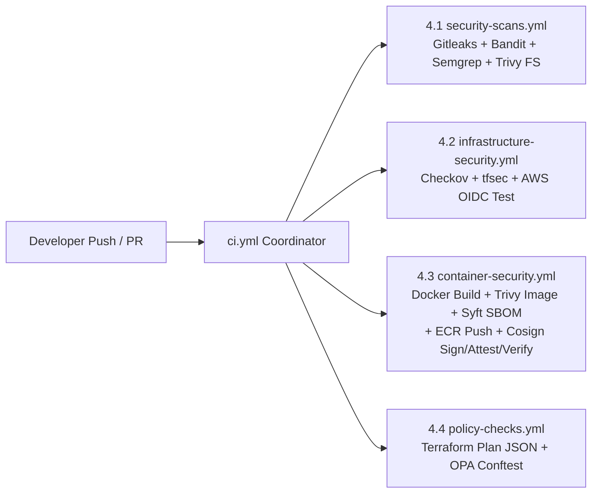

# 01. System Architecture & Security Controls

[← Back to Main Overview](../README.md)

> **Scope:** This document provides the architectural blueprint across all three engineering tracks of the SentinelPay platform: **Application Security (`payments-api` & `kyc-api`)**, **Cloud Security & Terraform Infrastructure (`eu-west-1`)**, and **DevSecOps CI/CD & Software Supply-Chain Security**.

---

## 1. Application Layer Architecture (`payments-api` & `kyc-api`)

SentinelPay's application tier comprises two containerized Python 3.11 Flask microservices deployed on AWS ECS Fargate and backed by shared Amazon RDS PostgreSQL 17 (`:5432`) and Amazon ElastiCache Redis (`:6379`) data stores, alongside external integrations for AWS S3 KYC storage, BVN identity verification, and merchant transaction webhooks.

### Microservice Route & Trust Boundary Inventory

#### `payments-api` (Flask / Gunicorn — Port `8001`)

| Full Route | Method | Needs Auth | Money | KYC Data | Functional Role & Remediated Vulnerability Mapping |
| :--- | :--- | :--- | :--- | :--- | :--- |
| `/health` | `GET` | No | No | No | Container and ALB target group health check probe. |
| `/v1/auth/register` | `POST` | No | No | No | Creates merchant identity records in `users`; hardened with Argon2id hashing (`V-APP-06`) and Redis rate limiting (`V-APP-08`). |
| `/v1/auth/login` | `POST` | No | No | No | Authenticates users, transparently upgrades legacy MD5 hashes to Argon2id (`V-APP-06`), enforces `5/min` rate limits (`V-APP-08`), and issues `RS256` JWTs (`V-APP-02`). |
| `/v1/auth/otp` | `POST` | No | No | No | Generates OTPs; hardened with Redis rate limiting (`V-APP-08`) and secret-masked logs (`V-APP-11`). |
| `/v1/accounts/<account_id>` | `GET` | Yes | Reads | No | Reads account balance, currency, and status; enforces `WHERE id = %s AND user_id = %s` ownership checks (`V-APP-03` IDOR). |
| `/v1/accounts/` | `GET` | Yes | Reads | No | Lists all accounts belonging to the authenticated caller. |
| `/v1/accounts/<account_id>/profile` | `PUT` | Yes | Can write | No | Updates account profile; whitelists only `account_number` and `currency` to prevent mass assignment (`V-APP-07`). |
| `/v1/transactions/search` | `GET` | Yes | Reads | No | Searches transaction records; hardened with `psycopg2` parameterized `%s` queries (`V-APP-01` SQLi). |
| `/v1/transactions/<reference>` | `GET` | Yes | Reads | No | Retrieves transaction details by unique reference. |
| `/v1/wallets/<account_id>/credit` | `POST` | Yes | Writes | No | Credits wallet balance; enforces account ownership (`V-APP-03`) and structured audit logging (`V-APP-11`). |
| `/v1/wallets/<account_id>/debit` | `POST` | Yes | Writes | No | Debits wallet balance; enforces PostgreSQL `SELECT ... FOR UPDATE` row-level locking (`V-APP-05` race condition), ownership (`V-APP-03`), and `sentinelpay.audit` logging (`V-APP-11`). |
| `/v1/webhooks/` | `POST` | Yes | No | No | Registers merchant webhook URLs; validates destination IPs via `validate_callback_url` (`V-APP-04` SSRF). |
| `/v1/webhooks/test` | `POST` | Yes | No | No | Test-fires webhook; blocks private, loopback, link-local, and metadata IPs with `allow_redirects=False` (`V-APP-04` SSRF). |
| `/v1/admin/session/restore` | `POST` | Yes (Admin) | No | No | Restores admin sessions; replaced `pickle.loads()` with `itsdangerous.URLSafeTimedSerializer` (`V-APP-10` RCE). |
| `/v1/admin/users` | `GET` | Yes (Admin) | No | No | Lists all platform users; protected by `RS256` JWT verification and explicit `admin` role checks (`V-APP-02`). |

#### `kyc-api` (Flask / Gunicorn — Port `8002`)

| Full Route | Method | Needs Auth | Money | KYC Data | Functional Role & Remediated Vulnerability Mapping |
| :--- | :--- | :--- | :--- | :--- | :--- |
| `/health` | `GET` | No | No | No | Container and ALB target group health check probe. |
| `/v1/verify/bvn` | `POST` | Yes | No | Processes KYC ID | Submits BVN to external provider; locked to a hardcoded server-side provider URL map (`V-APP-04` SSRF). |
| `/v1/verify/lookup` | `GET` | Yes | No | Reads KYC | Queries `kyc_records` by BVN or NIN; remediated with parameterized `%s` queries (`V-APP-01` SQLi). |
| `/v1/documents/upload` | `POST` | Yes | No | Writes KYC | Uploads identity documents to the KMS-encrypted S3 KYC bucket under `users/{user_id}/`. |
| `/v1/documents/<path:key>` | `GET` | Yes | No | Reads KYC | Retrieves KYC documents from S3; strictly enforces caller namespace ownership (`users/{user_id}/`) (`V-APP-03` IDOR). |

### Application Vulnerability Register (`V-APP-01` – `V-APP-11`)

| ID | Vulnerability | Risk | Root Cause in Legacy Code | Engineered Security Control |
| :--- | :--- | :--- | :--- | :--- |
| **`V-APP-01`** | **SQL Injection** | Critical | `f-strings` and `.format()` concatenated untrusted query parameters into SQL statements. | Rewrote queries using `psycopg2` parameterized `%s` placeholders. |
| **`V-APP-02`** | **Broken JWT Auth** | Critical | Symmetric `HS256` with weak secrets and no algorithm validation (`alg: none` bypass). | Migrated to asymmetric `RS256` (`JWT_PRIVATE_KEY` / `JWT_PUBLIC_KEY`), 15-min expiry, and refresh rotation. |
| **`V-APP-03`** | **IDOR** | High | Queried accounts/wallets via `WHERE id = %s` and S3 keys without checking caller ownership. | Enforced `WHERE id = %s AND user_id = %s` in SQL and `users/{user_id}/` prefix validation in S3. |
| **`V-APP-04`** | **SSRF** | High | Passed unvalidated URLs to `requests.get()`/`post()` with redirects enabled. | Built `validate_callback_url` (HTTPS-only, blocks private/loopback/metadata IPs, `allow_redirects=False`). |
| **`V-APP-05`** | **Race Condition** | Critical | Sequential `SELECT balance` and `UPDATE` allowed concurrent double-spending. | Wrapped debits in a transaction with PostgreSQL row-level locking (`SELECT ... FOR UPDATE`). |
| **`V-APP-06`** | **Weak Hashing** | High | Stored unsalted `hashlib.md5()` password hashes. | Migrated to `Argon2id` (`argon2-cffi`) with transparent login-time re-hashing of legacy MD5 hashes. |
| **`V-APP-07`** | **Mass Assignment** | High | Dynamically bound raw JSON keys to SQL `UPDATE` columns on `/profile`. | Whitelisted only `account_number` and `currency`, rejecting unknown fields. |
| **`V-APP-08`** | **Missing Rate Limit** | Medium | Auth and OTP endpoints allowed unlimited brute-force attempts. | Added Redis-backed `Flask-Limiter` (`5/minute`) keyed by IP and hashed canonical email/E.164 phone. |
| **`V-APP-09`** | **Verbose Errors** | Low | Ran with `debug=True` and leaked stack traces. | Enforced `debug=False`, added `@app.errorhandler(HTTPException)` (`404`/`405`), and sanitized `500` responses. |
| **`V-APP-10`** | **Pickle RCE** | Critical | Used `pickle.loads()` on untrusted session blobs at `/v1/admin/session/restore`. | Replaced `pickle` with `itsdangerous.URLSafeTimedSerializer` signed JSON payloads. |
| **`V-APP-11`** | **Audit Log Gap** | Medium | Financial debits/credits and KYC changes lacked structured audit trails. | Built `sentinelpay.audit` structured JSON logger recording actor, action, target, reference, amount, and IP. |

---

## 2. Cloud Security & Modular Terraform Architecture (`infra/`)

The AWS environment in `eu-west-1` is rooted at `infra/environments/dev` and decomposes infrastructure into reusable modules under `infra/modules/`, backed by an out-of-band `Bootstrap/` state configuration (S3 bucket with versioning/encryption + DynamoDB lock table with KMS encryption and 35-day Point-in-Time Recovery).

### Terraform Module Inventory & Security Purpose

| Module Path | Provisioned AWS Resources | Security Controls Implemented |
| :--- | :--- | :--- |
| **`Bootstrap/`** | `aws_s3_bucket.terraform_state`, `aws_dynamodb_table.terraform_locks` | `prevent_destroy = true`, Versioning, Server-Side Encryption, Public Access Block, DynamoDB `LockID` locking & 35-day PITR. |
| **`modules/network`** | VPC, 2 Public & 2 Private Subnets (`eu-west-1a/1b`), IGW, NAT Gateway, VPC Endpoints, Flow Logs | `map_public_ip_on_launch = false` (`CKV_AWS_130`), empty `default` SG (`default-deny`), PrivateLink endpoints (S3, ECR, Secrets Manager, KMS, CloudWatch), 365-day KMS-encrypted VPC Flow Logs. |
| **`modules/edge`** | Application Load Balancer (`aws_lb`), Target Groups, HTTPS/HTTP Listeners, AWS WAFv2 Web ACL | `drop_invalid_header_fields = true`, `enable_deletion_protection = true`, HTTP/2, S3 access logging, `ELBSecurityPolicy-TLS13-1-2-2021-06`, HTTP `301` redirect, WAFv2 (`CommonRuleSet` & `KnownBadInputsRuleSet`), 365-day KMS WAF logs with `authorization` header redaction. |
| **`modules/compute`** | ECS Fargate Cluster, Task Definitions, Services, Security Groups, CloudWatch Log Group | `containerInsights = "enabled"` (`CKV_AWS_65`), `assign_public_ip = false`, ingress restricted strictly to `alb_security_group_id`, scoped egress (`:443`, `:5432`, `:6379`, `:53`), 365-day KMS-encrypted logs. |
| **`modules/rds`** | Multi-AZ RDS PostgreSQL 17 (`db.t4g.micro`), Subnet Group, Parameter Group, Enhanced Monitoring Role | `storage_encrypted = true` (KMS), `multi_az = true`, `publicly_accessible = false`, `iam_database_authentication_enabled = true`, `rds.force_ssl = 1`, query logging (`ddl`), Performance Insights (KMS), Deletion Protection, ingress restricted to ECS & Rotation Lambda SGs. |
| **`modules/data` (`redis` & `s3`)** | Account S3 Public Access Block, S3 Access Logs Bucket, S3 KYC Bucket, ElastiCache Redis (2-node `cache.t4g.micro`) | S3 KYC Object Lock (`GOVERNANCE`, 90 days), KMS encryption with Bucket Keys, Versioning, EventBridge notifications; Redis `at_rest_encryption_enabled = true`, `transit_encryption_enabled = true`, automatic failover, 32-char `auth_token` in Secrets Manager, ingress restricted to ECS SG (`:6379`). |
| **`modules/security-iam` & `modules/kms`** | `kms-admin` & `kms-user` IAM Roles, Customer-Managed KMS Key (`alias/sentinelpay-dev-data`) | 30-day deletion window, `enable_key_rotation = true`, least-privilege separation between key administrators and cryptographic users, condition-scoped service grants. |
| **`modules/secrets-rotation`** | Secrets Manager DB Secret (`sentinelpay/dev/database`), Rotation Lambda (`python3.13`), AWS Signer, SQS DLQ | Automated 30-day PostgreSQL password rotation (`createSecret`, `setSecret`, `testSecret`, `finishSecret`) with `sslmode='verify-full'`, AWS Signer code signing (`CKV_AWS_272`), X-Ray active tracing (`CKV_AWS_50`), KMS-encrypted SQS DLQ (`CKV_AWS_116`). |
| **`modules/identity-center`** | AWS IAM Identity Center Permission Set (`sentinelpay-Developer`) | Enforces 4-hour maximum session duration (`PT4H`) with `ReadOnlyAccess` for human administrative separation. |
| **`modules/github-oidc`** | IAM OIDC Provider (`token.actions.githubusercontent.com`), Role (`sentinelpay-dev-github-actions`) | Keyless `sts:AssumeRoleWithWebIdentity` locked to audience `sts.amazonaws.com` and immutable repo/branch/PR subject claims; least-privilege ECR/ECS deployment policy. |
| **`modules/detection`** | Multi-Region CloudTrail, GuardDuty, Security Hub, AWS Config, IAM Honeytoken, Quarantine Lambda | CloudTrail S3 Object Lock (`COMPLIANCE`, 365 days) + log validation + SNS + TLS-only bucket policy; GuardDuty (S3, EBS malware, RDS, Lambda); Security Hub (FSBP v1.0.0 & CIS v5.0.0); Config (CIS v1.4 L2 pack); Honeytoken (`sentinelpay-dev-honeytoken`) + EventBridge alarm; Severity `>= 7` Quarantine Lambda isolating ENIs into `sentinelpay-dev-quarantine` SG. |

---

## 3. DevSecOps CI/CD & Software Supply-Chain Architecture (`.github/workflows/`)

To prevent monolithic pipeline sprawl, `.github/workflows/ci.yml` acts as a central orchestrator invoking four domain-specific reusable workflows across every pull request and push to `main`:

### Reusable Workflow Responsibilities & Enforcement Matrix

| Workflow File | Tools & Controls Executed | Blocking & Evidence Behavior |
| :--- | :--- | :--- |
| **`ci.yml`** | Central pipeline coordinator. | Enforces PR-only delivery into protected `main` with mandatory review and status checks. |
| **`security-scans.yml`** | **Gitleaks** (`.gitleaks.toml` + `gitleaks-baseline.json`), **Bandit**, **Semgrep** (`--error`), **Trivy** (filesystem/dependency scan). | Any unbaselined secret in Git history, High-severity Bandit issue, ERROR-level Semgrep match, or High/Critical dependency CVE blocks the workflow and uploads JSON reports. |
| **`infrastructure-security.yml`** | **Checkov**, **tfsec**, and **AWS OIDC Authentication Test** (`sts:AssumeRoleWithWebIdentity`). | Blocks on High/Critical `tfsec` findings and specified priority Checkov checks; verifies live OIDC token exchange against `sentinelpay-dev-github-actions`. |
| **`container-security.yml`** | **Docker**, **Trivy Image Scan**, **Syft** (`CycloneDX`), **Amazon ECR**, **Cosign / Sigstore**, `verify_supply_chain.sh`. | Builds `payments-api` & `kyc-api`, scans both images before enforcing the combined `if: always()` CRITICAL gate, generates `payments-sbom.cdx.json` & `kyc-sbom.cdx.json`, pushes to immutable ECR, resolves `sha256` digests, signs & attests keylessly with Cosign, and verifies transparency-log claims. |
| **`policy-checks.yml`** | **AWS OIDC**, **Terraform** (`init`, `validate`, `plan`, `show -json`), **OPA / Rego / Conftest** (`--all-namespaces`). | Authenticates via OIDC to access the S3 state backend in `infra/environments/dev`, generates plan JSON, and evaluates 4 Rego policy packages (`s3_public.rego`, `network_ingress.rego`, `encryption.rego`, `iam_wildcard.rego`). |