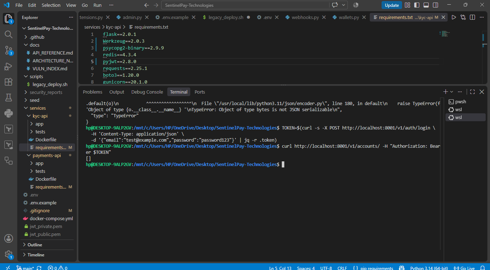

# SentinelPay: End-to-End Setup & Implementation Guide

[← Back to Main Overview](../README.md)

> **Scope:** This guide provides the complete, step-by-step implementation instructions across all four engineering phases of the SentinelPay platform:
> 1. **Phase 1 — Application Security (AppSec) Code Remediation & Container Hardening** (`V-APP-01` through `V-APP-11` & Alpine/Gunicorn Dockerfiles)
> 2. **Phase 2 — DevSecOps CI/CD Pipeline, Policy as Code & Container Supply-Chain Security** (GitHub Actions, AWS OIDC, OPA/Conftest, Syft SBOMs & Cosign)
> 3. **Phase 3 — Cloud Security & Modular Terraform Infrastructure Provisioning** (Remote State Bootstrap, Multi-AZ VPC, ECS Fargate, RDS, Redis, KMS, Secrets Rotation & Threat Detection in `eu-west-1`)
> 4. **Phase 4 — Live Cloud Container Deployment, OWASP ZAP DAST Execution & Remediation** (ECS Stabilization, Passive/Active ZAP Scanning, ACM TLS Cutover & Defensive Header Injection)

---

## Table of Contents
- [0. Prerequisites & Local Toolchain Setup](#0-prerequisites--local-toolchain-setup)
- [1. Phase 1: Application Security (AppSec) Code Remediation & Container Hardening](#1-phase-1-application-security-appsec-code-remediation--container-hardening)
- [2. Phase 2: DevSecOps CI/CD Pipeline, Policy as Code & Supply-Chain Security](#2-phase-2-devsecops-cicd-pipeline-policy-as-code--supply-chain-security)
- [3. Phase 3: Cloud Security & Modular Terraform Infrastructure Provisioning](#3-phase-3-cloud-security-modular-terraform-infrastructure-provisioning)
- [4. Phase 4: Live Container Deployment, OWASP ZAP DAST Execution & Remediation](#4-phase-4-live-container-deployment-owasp-zap-dast-execution--remediation)

---

## 0. Prerequisites & Local Toolchain Setup

Before beginning the implementation, install and verify the required tools on your workstation (established in Cycle 1 so scanner and build behavior can be validated locally before relying on CI):

| Category | Required Tools & Versions | Purpose |
| :--- | :--- | :--- |
| **Runtime & Containers** | Python `3.11+`, Docker Engine / Docker Desktop, Docker Compose | Running `payments-api` (`:8001`), `kyc-api` (`:8002`), PostgreSQL (`:5432`), and Redis (`:6379`) locally. |
| **Cloud & IaC** | AWS CLI v2 (configured for `eu-west-1`), Terraform `>= 1.7.0` (`aws` `v6.62.0`, `random` `v3.9.0`, `archive` `v2.8.0`), OpenSSL | Provisioning AWS infrastructure, managing remote state, and generating X.509 TLS certificates. |
| **AppSec & SAST / Secrets** | `Gitleaks`, `Bandit`, `Semgrep`, `security_scan.py` | Detecting hardcoded secrets in Git history and static vulnerabilities in Python services. |
| **SCA, IaC & Policy as Code** | `Trivy`, `Checkov`, `tfsec`, `OPA / Conftest` | Scanning dependencies, Docker images, Terraform HCL, and Terraform plan JSON against custom Rego policies. |
| **Supply Chain & DAST** | `Syft`, `Cosign` (Sigstore), `OWASP ZAP v2.17.0` (`ghcr.io/zaproxy/zaproxy:stable`) | Generating CycloneDX SBOMs, keyless container signing/verification, and dynamic penetration testing. |

---

## 1. Phase 1: Application Security (AppSec) Code Remediation & Container Hardening

### Step 1.1: Automated Vulnerability Scanning & Triage (`security_scan.py`)
1. Map the 20 endpoints across `payments-api` (`Flask :8001`) and `kyc-api` (`Flask :8002`) and run the automated scanner orchestration script (`security_scan.py`) executing **Semgrep**, **Gitleaks**, and **Bandit** across the repository:
   ```bash
   python3 security_scan.py
   ```
2. Export the scan results into the custom **Microsoft Power BI Vulnerability Dashboard** to deduplicate overlapping detections (30 Semgrep, 29 Gitleaks, 13 Bandit = **36 Critical, 3 High, 20 Medium, 5 Low**) and prioritize the top vulnerable files (`docker-compose.yml`, `.github/workflows/ci.yml`, `scripts/legacy_deploy.sh`, `services/kyc-api/app/routes/documents.py`, `services/kyc-api/app/routes/verify.py`, `services/payments-api/app/auth.py`, and `services/payments-api/app/routes/admin.py`).

### Step 1.2: Local Baseline Functional Setup
Start the local multi-container environment and verify baseline authentication and wallet funding before executing exploit tests:

```bash
docker compose up -d --build
```



*Figure 1.1: Baseline authentication and initial wallet credit verification on localhost.*

---

### Step 1.3: Step-by-Step Vulnerability Remediation & Verification (`V-APP-01` – `V-APP-11`)

#### 1. `V-APP-01` — SQL Injection (Critical)
* **Vulnerable Endpoints:** `GET /v1/transactions/search` (`payments-api`) and `GET /v1/verify/lookup` (`kyc-api`).
* **Code Remediation:** Remove all Python `f-strings` and `.format()` string interpolation from database queries in `services/payments-api/app/routes/transactions.py` and `services/kyc-api/app/routes/verify.py`. Rewrite every SQL statement to use `psycopg2` parameterized `%s` placeholders so the PostgreSQL engine treats user input strictly as literal values:
  ```python
  # Remediated parameterized query pattern
  cur.execute(
      "SELECT id, user_id, bvn, nin, verification_status, document_url, submitted_at "
      "FROM kyc_records WHERE bvn = %s OR nin = %s",
      (bvn, nin),
  )
  ```
* **Verification Commands:**
  ```bash
  # Test SQLi payloads against both endpoints (must return empty [] rather than dumping all rows)
  curl -sG "$PAYMENTS/v1/transactions/search" \
    -H "Authorization: Bearer $TOKEN" \
    --data-urlencode "q=') OR 1=1 -- "

  curl -sG "$KYC/v1/verify/lookup" \
    -H "Authorization: Bearer $TOKEN" \
    --data-urlencode "bvn=98765432109' OR 1=1--"
  ```

#### 2. `V-APP-02` — Broken JWT Implementation & Algorithm Confusion (Critical)
* **Vulnerable Endpoints:** All endpoints wrapped in `@require_auth` (`POST /v1/auth/login`, `GET /v1/accounts/`, `GET /v1/admin/users`, etc.).
* **Code Remediation:** In `services/payments-api/app/auth.py` and `services/kyc-api/app/auth.py`, replace symmetric `HS256` signing and default secret fallbacks with asymmetric **`RS256`** cryptography (`JWT_PRIVATE_KEY` for token issuance, `JWT_PUBLIC_KEY` for verification). Explicitly enforce `algorithms=["RS256"]` (rejecting `alg: none` and unverified headers), set a 15-minute access token expiration, and implement refresh-token rotation.
* **Verification Commands:**
  ```bash
  # Attempt to forge an unsigned 'alg: none' admin JWT and access /v1/admin/users
  export FORGED_TOKEN="$(python3 - <<'PY'
  import base64, json
  def b64(obj):
      raw = json.dumps(obj, separators=(",", ":")).encode()
      return base64.urlsafe_b64encode(raw).rstrip(b"=").decode()
  header = {"alg": "none", "typ": "JWT"}
  payload = {"user_id": 1, "role": "admin"}
  print(f"{b64(header)}.{b64(payload)}.")
  PY
  )"

  curl -i "$PAYMENTS/v1/admin/users" -H "Authorization: Bearer $FORGED_TOKEN"
  # Expected Result: HTTP/1.1 401 UNAUTHORIZED
  ```


*Figure 1.2: Forged `alg: none` JWT previously dumped `/v1/admin/users` (`200 OK`); after migrating to `RS256`, forged tokens are rejected with `401 UNAUTHORIZED`.*

#### 3. `V-APP-03` — Insecure Direct Object Reference / IDOR (High)
* **Vulnerable Endpoints:** `GET /v1/accounts/<account_id>`, `POST /v1/wallets/<account_id>/credit`, `POST /v1/wallets/<account_id>/debit`, and `GET /v1/documents/<path:key>`.
* **Code Remediation:**
  1. In `services/payments-api/app/routes/accounts.py`, `transactions.py`, and `wallets.py`, update SQL queries from `WHERE id = %s` to enforce caller ownership: `WHERE id = %s AND user_id = %s` (passing `request.current_user_id`).
  2. In `services/kyc-api/app/routes/documents.py`, restrict S3 document downloads to the authenticated caller's prefix (`users/{request.current_user_id}/`).
* **Verification Commands:**
  ```bash
  # Authenticated as user_id=3 (owns account 3, does NOT own account 1 or 6)
  curl -i "$PAYMENTS/v1/accounts/1" -H "Authorization: Bearer $TOKEN"
  # Expected: HTTP/1.1 404 NOT FOUND {"error":"account not found"}

  curl -i "$PAYMENTS/v1/accounts/3" -H "Authorization: Bearer $TOKEN"
  # Expected: HTTP/1.1 200 OK
  ```


*Figure 1.3: Enforcing `WHERE id = %s AND user_id = %s` blocks cross-tenant access to `/v1/accounts/1` (`404 NOT FOUND`) while preserving access to owned `/v1/accounts/3` (`200 OK`).*

#### 4. `V-APP-04` — Server-Side Request Forgery / SSRF (High)
* **Vulnerable Endpoints:** `POST /v1/webhooks/`, `POST /v1/webhooks/test`, and `POST /v1/verify/bvn`.
* **Code Remediation:** Implement `validate_callback_url()` in `services/payments-api/app/routes/webhooks.py` to require the `https` scheme, resolve the hostname via DNS, and reject private (`10.0.0.0/8`, `172.16.0.0/12`, `192.168.0.0/16`), loopback (`127.0.0.0/8`), link-local/cloud metadata (`169.254.169.254`), and multicast IP ranges. Disable redirects (`allow_redirects=False`) on outbound `requests.post()`/`get()` calls to prevent DNS rebinding, and lock `/v1/verify/bvn` to a server-side provider configuration map.
* **Verification Commands:**
  ```bash
  curl -sX POST "$PAYMENTS/v1/webhooks/test" \
    -H "Authorization: Bearer $TOKEN" -H "Content-Type: application/json" \
    -d '{"url":"[http://127.0.0.1:8001/health](http://127.0.0.1:8001/health)"}'
  # Expected: {"error":"callback must use HTTPS"}

  curl -sX POST "$PAYMENTS/v1/webhooks/test" \
    -H "Authorization: Bearer $TOKEN" -H "Content-Type: application/json" \
    -d '{"url":"[https://127.0.0.1:8001/health](https://127.0.0.1:8001/health)"}'
  # Expected: {"error":"private/reserved destination is not allowed"}
  ```

#### 5. `V-APP-05` — Wallet Debit TOCTOU Race Condition (Critical)
* **Vulnerable Endpoint:** `POST /v1/wallets/<account_id>/debit`.
* **Code Remediation:** In `services/payments-api/app/routes/wallets.py`, wrap the balance check, deduction, and transaction insert inside an atomic database transaction block using PostgreSQL row-level locking (`SELECT balance FROM accounts WHERE id = %s AND user_id = %s FOR UPDATE`). Concurrent debit requests against the same wallet now queue sequentially rather than reading stale balances in parallel.
* **Verification Commands:**
  ```bash
  # Fire 10 simultaneous 4000.00 debit requests against an account with an 8200.00 balance
  seq 1 10 | xargs -n1 -P10 -I{} \
    curl -sX POST "$PAYMENTS/v1/wallets/4/debit" \
      -H "Authorization: Bearer $TOKEN" \
      -H "Content-Type: application/json" \
      -d '{"amount":"4000.00","description":"V-APP-05 race test"}'
  # Expected: Exactly 2 debits succeed (new_balance: 4200.00 -> 200.00) and 8 return {"error":"insufficient funds"}
  ```

#### 6. `V-APP-06` — Weak Password Hashing (High)
* **Vulnerable Endpoints:** `POST /v1/auth/register` and `POST /v1/auth/login`.
* **Code Remediation:** Replace `hashlib.md5()` with **Argon2id** via `argon2-cffi` (`PasswordHasher()`). Implement a transparent login-time migration in `/v1/auth/login`: when an existing user authenticates against a legacy MD5 hash, verify the MD5 digest once, immediately re-hash the plaintext password with Argon2id (`$argon2id$v=19$m=65536,t=3,p=4$...`), and update `users.password_hash` in PostgreSQL.
* **Verification Commands:**
  ```bash
  docker compose exec -T postgres psql -U sentinel -d sentinelpay \
    -c "SELECT email, password_hash FROM users WHERE email = 'merchant1@example.com';"
  ```

#### 7. `V-APP-07` — Mass Assignment on Account Profile (High)
* **Vulnerable Endpoint:** `PUT /v1/accounts/<account_id>/profile`.
* **Code Remediation:** Remove dynamic dictionary-key iteration in `services/payments-api/app/routes/accounts.py`. Enforce a strict field whitelist permitting updates only to `account_number` and `currency`, explicitly rejecting requests containing protected columns such as `balance`, `status`, `role`, or `user_id`.
* **Verification Commands:**
  ```bash
  curl -iX PUT "$PAYMENTS/v1/accounts/3/profile" \
    -H "Authorization: Bearer $TOKEN" -H "Content-Type: application/json" \
    -d '{"balance":"999999.99"}'
  # Expected: HTTP/1.1 401 UNAUTHORIZED {"error":"unauthorized"}
  ```

#### 8. `V-APP-08` — Missing Rate Limiting on Auth & Identity Endpoints (Medium)
* **Vulnerable Endpoints:** `POST /v1/auth/login`, `POST /v1/auth/register`, and `POST /v1/auth/otp`.
* **Code Remediation:** Initialize a centralized `Flask-Limiter` instance backed by Redis (`redis://redis:6379`) and apply strict rate-limit decorators (e.g., `5/minute`). Scope rate-limit keys by both client IP and cryptographically hashed, canonicalized account identifiers (normalized lowercase email addresses and E.164 phone numbers).
* **Verification Commands:**
  ```bash
  for i in $(seq 1 15); do
    curl -s -o /dev/null -w "attempt=$i status=%{http_code}\n" \
      -X POST "$PAYMENTS/v1/auth/otp" \
      -H "Content-Type: application/json" \
      -d '{"phone":"+2348000000000"}'
  done
  # Expected: Attempts 1-5 return 200; Attempts 6-15 are throttled
  ```

#### 9. `V-APP-09` — Verbose Error & Traceback Disclosure (Low)
* **Vulnerable Scope:** Global application error handling across `payments-api` and `kyc-api`.
* **Code Remediation:** Enforce `debug=False` in production and register a global `@app.errorhandler(Exception)` boundary that logs full stack traces server-side via `app.logger.exception()` while returning a generic JSON error payload to the client.

#### 10. `V-APP-10` — Insecure `pickle` Deserialization / RCE (Critical)
* **Vulnerable Endpoint:** `POST /v1/admin/session/restore`.
* **Code Remediation:** Completely remove Python's `pickle` module (`pickle.loads()`) from `services/payments-api/app/routes/admin.py` and replace it with `itsdangerous.URLSafeTimedSerializer`, ensuring only cryptographically signed, time-bound JSON session blobs are accepted.
* **Verification Commands:**
  ```bash
  export SAFE_PICKLE="$(python3 - <<'PY'
  import base64, pickle
  obj = {"probe": "V-APP-10", "purpose": "safe deserialization test"}
  print(base64.b64encode(pickle.dumps(obj)).decode())
  PY
  )"

  curl -iX POST "$PAYMENTS/v1/admin/session/restore" \
    -H "Authorization: Bearer $TOKEN" -H "Content-Type: application/json" \
    -d "{\"session\":\"$SAFE_PICKLE\"}"
  # Expected: HTTP/1.1 401 UNAUTHORIZED {"error":"unauthorized"}
  ```


*Figure 1.4: Replacing `pickle.loads()` with `itsdangerous.URLSafeTimedSerializer` blocks untrusted serialized payloads with `401 UNAUTHORIZED`.*

#### 11. `V-APP-11` — Compliance Audit Logging Gap (Medium)
* **Vulnerable Endpoints:** `POST /v1/wallets/<account_id>/credit`, `POST /v1/wallets/<account_id>/debit`, and `PUT /v1/verify/<record_id>/status`.
* **Code Remediation:** Create `audit.py` (`logging.getLogger("sentinelpay.audit")`) in both microservices to emit structured JSON audit records containing `timestamp`, `event`, `actor_user_id`, `action`, `target`, `account_id`, `reference`, `amount`, `currency`, `counterparty`, and `ip`, paired with a sanitization filter that masks passwords, OTPs, and tokens.
* **Verification Commands:**
  ```bash
  curl -sX POST "$PAYMENTS/v1/wallets/3/debit" \
    -H "Authorization: Bearer $TOKEN" -H "Content-Type: application/json" \
    -d '{"amount":"1.00","description":"V-APP-11 audit log test"}'

  docker compose logs --since=1m payments-api
  ```


*Figure 1.5: Verifying structured `sentinelpay.audit` JSON log emission upon wallet debit execution.*

---

### Step 1.4: Refactoring & Hardening Service `Dockerfile` Definitions
Refactor `services/payments-api/Dockerfile` and `services/kyc-api/Dockerfile` to migrate from `python:3.11` root images to minimal `python:3.11-alpine` images, upgrade OS packages, strip lock/backup files, enforce non-root execution (`USER appuser`), add a native `HEALTHCHECK`, and serve requests via production **Gunicorn** workers:

```dockerfile
FROM python:3.11-alpine

RUN apk update && apk upgrade --no-cache

WORKDIR /app

COPY requirements.txt .
RUN pip install --upgrade --no-cache-dir pip setuptools wheel && \
    pip install --no-cache-dir -r requirements.txt

COPY . .
RUN rm -f *.lock *old.txt *bak.txt Pipfile* poetry*

# Create a non-root user and group, then change ownership of the working directory
RUN addgroup -S appgroup && \
    adduser -S -G appgroup -h /app -s /sbin/nologin appuser && \
    chown -R appuser:appgroup /app

# Native HEALTHCHECK for the application (port 8001 for payments-api, 8002 for kyc-api)
HEALTHCHECK --interval=30s --timeout=10s --start-period=5s --retries=3 \
  CMD python -c "import urllib.request; urllib.request.urlopen('http://localhost:8002/health')" || exit 1

# CK-02 & IV-05 — Enforce the non-root USER directive
USER appuser

EXPOSE 8002

CMD ["gunicorn", "--bind", "0.0.0.0:8002", "--workers", "2", "app.main:create_app()"]
```

---

## 2. Phase 2: DevSecOps CI/CD Pipeline, Policy as Code & Supply-Chain Security

### Step 2.1: Repository Governance & Reusable Workflow Architecture (Cycle 1)
1. **Configure Branch Protection on `main`:** In GitHub Settings → Branches, protect `main` so direct pushes are rejected, changes require a Pull Request with at least one approving review, and all CI security checks must pass before merging.
2. **Modularize GitHub Actions Workflows (`.github/workflows/`):** Structure `.github/workflows/ci.yml` as the central orchestrator calling four domain-specific reusable workflows with 5-minute fail-closed job timeouts:
   * `.github/workflows/ci.yml` — Main coordinator triggered on `pull_request` and `push`.
   * `.github/workflows/security-scans.yml` — Runs **Gitleaks**, **Bandit**, **Semgrep**, and **Trivy** (filesystem/dependency scan).
   * `.github/workflows/infrastructure-security.yml` — Runs **Checkov**, **tfsec**, and the **AWS OIDC Authentication Test**.
   * `.github/workflows/container-security.yml` — Builds both service images, runs **Trivy** container image scans, generates **Syft** CycloneDX SBOMs, promotes images to **Amazon ECR**, and executes **Cosign** keyless signing, attestation, and verification.
   * `.github/workflows/policy-checks.yml` — Assumes the AWS OIDC role, runs `terraform init` and `terraform plan` in `infra/environments/dev`, and evaluates the plan JSON with **OPA / Conftest**.

### Step 2.2: Secret Scanning, SAST & Dependency Gates (`security-scans.yml`)
1. **Configure Custom Gitleaks Rules (`.gitleaks.toml` & `gitleaks-baseline.json`):** Define custom regex detectors for `sentinelpay-sensitive-env`, `sentinelpay-database-url`, `sentinelpay-slack-webhook`, and `sentinelpay-terraform-secret` in `.gitleaks.toml` while recording historical pre-remediation commits and intentional honeytoken references in `gitleaks-baseline.json`.
2. **Configure Documented Trivy Exceptions (`.trivyignore`):** Scope exceptions for pip's internal vendored `msgpack` (`GHSA-6v7p-g79w-8964`) and `setuptools` (`CVE-2025-47273`) vulnerabilities.
3. **Execute Local Gate Verification:**
   ```bash
   # 1. Full Git history secret scan compared against baseline
   gitleaks detect --config .gitleaks.toml --baseline-path gitleaks-baseline.json --redact -v

   # 2. Bandit Python SAST scan (High severity blocking)
   bandit -r Amdari-Project--02/services/ -ll -ii -f json -o bandit-report.json

   # 3. Semgrep SAST scan (--error blocks on ERROR-level findings)
   semgrep scan --config auto --error Amdari-Project--02/services/

   # 4. Trivy filesystem & dependency scan
   trivy fs --severity HIGH,CRITICAL --ignorefile .trivyignore --exit-code 1 Amdari-Project--02/
   ```

### Step 2.3: Keyless AWS OIDC Federation Setup (`infrastructure-security.yml`)
Instead of storing static AWS access keys in GitHub Secrets, configure GitHub Actions to exchange short-lived OIDC tokens with AWS STS (`sts:AssumeRoleWithWebIdentity`):
1. Set the repository variable `AWS_ROLE_ARN` to `arn:aws:iam::105045466108:role/sentinelpay-dev-github-actions`.
2. Wire `aws-actions/configure-aws-credentials@v6.2.3` into `infrastructure-security.yml`, `container-security.yml`, and `policy-checks.yml`:
   ```yaml
   - name: Configure AWS credentials using OIDC
     uses: aws-actions/configure-aws-credentials@v6.2.3
     with:
       role-to-assume: ${{ vars.AWS_ROLE_ARN }}
       aws-region: eu-west-1
   ```
3. Ensure the IAM trust policy in `infra/modules/github-oidc/main.tf` validates `"token.actions.githubusercontent.com:aud" = "sts.amazonaws.com"` and permits both the `main` branch and `pull_request` subjects:
   * `repo:sentinelpay-team@321830913/Sentinelpay@1348603997:ref:refs/heads/main`
   * `repo:sentinelpay-team@321830913/Sentinelpay@1348603997:pull_request`

### Step 2.4: Policy as Code with OPA Rego & Conftest (`policy-checks.yml` — Cycle 4)
1. **Author the 4 Rego Policy Packages (`policy/terraform/`):**
   * `policy/terraform/s3_public.rego` (`package terraform.s3`): Blocks S3 buckets with `public-read`, `public-read-write`, or `authenticated-read` ACLs, or any `aws_s3_bucket_public_access_block` where `block_public_acls`, `ignore_public_acls`, `block_public_policy`, or `restrict_public_buckets` is not `true`.
   * `policy/terraform/network_ingress.rego` (`package terraform.network`): Blocks any `aws_security_group_rule` allowing `0.0.0.0/0` ingress except TCP port `443` on the ALB.
   * `policy/terraform/encryption.rego` (`package terraform.encryption`): Blocks unencrypted `aws_db_instance`, `aws_ebs_volume`, `aws_dynamodb_table`, and `aws_s3_bucket_server_side_encryption_configuration` resources.
   * `policy/terraform/iam_wildcard.rego` (`package terraform.iam`): Blocks customer-managed `aws_iam_policy` resources containing `*` or service-level `:*` wildcard actions.
2. **Validate Rego Policies Against Paired Fixtures (`policy-tests/`):**
   ```bash
   # Secure fixtures must PASS; insecure fixtures must FAIL
   conftest test policy-tests/s3/secure.json -p policy/terraform --all-namespaces
   conftest test policy-tests/s3/insecure.json -p policy/terraform --all-namespaces
   conftest test policy-tests/network/secure.json -p policy/terraform --all-namespaces
   conftest test policy-tests/encryption/secure.json -p policy/terraform --all-namespaces
   conftest test policy-tests/iam/secure.json -p policy/terraform --all-namespaces
   ```
3. **Evaluate Real Terraform Plan JSON in `policy-checks.yml`:** Configure the workflow working directory to `infra/environments/dev` (so Terraform finds the root `.tf` files and authenticates to the S3 state backend via OIDC) and pipe the plan JSON to Conftest with `--all-namespaces`:
   ```bash
   cd infra/environments/dev
   terraform init
   terraform validate
   terraform plan -out=tfplan
   terraform show -json tfplan > tfplan.json
   conftest test tfplan.json -p ../../../policy/terraform --all-namespaces
   ```

### Step 2.5: Container Security Gate, Syft SBOMs & Keyless Cosign Provenance (`container-security.yml` — Cycle 5)
1. **Scan Both Service Images Before Enforcing the Gate:** In `container-security.yml`, run Trivy against both `payments-api` and `kyc-api` and use an `if: always()` gate step so a failure in the first image never hides vulnerabilities in the second image:
   ```yaml
   - name: Enforce Trivy image security gate
     if: always()
     run: |
       if [ "${{ steps.trivy_payments.outcome }}" = "failure" ] || \
          [ "${{ steps.trivy_kyc.outcome }}" = "failure" ]; then
         echo "Trivy scan failed or CRITICAL vulnerabilities detected in one or more SentinelPay images."
         exit 1
       fi
       echo "No CRITICAL vulnerabilities detected."
   ```
2. **Generate CycloneDX SBOMs with Syft:**
   ```bash
   syft sentinelpay-dev-payments-api:latest -o cyclonedx-json=payments-sbom.cdx.json
   syft sentinelpay-dev-kyc-api:latest -o cyclonedx-json=kyc-sbom.cdx.json
   ```
3. **Promote to Immutable ECR, Resolve `sha256` Digests & Sign/Attest Keylessly with Cosign:**
   Because Amazon ECR tag immutability is enabled, resolve the immutable `sha256` digest for each pushed image and bind keyless Sigstore/Cosign signatures and CycloneDX SBOM attestations directly to the digest-qualified URI:
   ```bash
   # Sign both image digests keylessly using GitHub OIDC identity
   cosign sign --yes "${PAYMENTS_IMAGE_DIGEST_URI}"
   cosign sign --yes "${KYC_IMAGE_DIGEST_URI}"

   # Attach CycloneDX SBOM attestations to both image digests
   cosign attest --yes --predicate payments-sbom.cdx.json --type cyclonedx "${PAYMENTS_IMAGE_DIGEST_URI}"
   cosign attest --yes --predicate kyc-sbom.cdx.json --type cyclonedx "${KYC_IMAGE_DIGEST_URI}"

   # Verify signatures and SBOM attestations (fail-closed pre-deployment check)
   ./Amdari-Project--02/scripts/verify_supply_chain.sh
   ```

---

## 3. Phase 3: Cloud Security & Modular Terraform Infrastructure Provisioning

### Step 3.1: Bootstrap Encrypted Remote State & Locking (`Bootstrap/`)
To prevent circular state dependencies, provision the S3 remote state bucket (`sentinelpay-terraform-state-*`) and DynamoDB state-locking table (`sentinelpay-terraform-locks`) first using the standalone `Bootstrap/` configuration:

```powershell
cd Bootstrap

# Initialize AWS (v6.62.0) and Random (v3.9.0) providers
terraform init

# Provision the S3 state bucket (versioned, AES256/KMS encrypted, public access blocked, prevent_destroy)
# and DynamoDB lock table (LockID hash key, SSE enabled, 35-day PITR)
terraform apply -auto-approve
```


*Figure 3.1: Provisioning the encrypted S3 state bucket and DynamoDB lock table in `eu-west-1`.*

Ensure the output `terraform_state_bucket` name is set in `infra/environments/dev/backend.tf`:
```hcl
terraform {
  backend "s3" {
    bucket         = "sentinelpay-terraform-state-3ed7fc7c"
    key            = "environments/dev/terraform.tfstate"
    region         = "eu-west-1"
    encrypt        = true
    dynamodb_table = "sentinelpay-terraform-locks"
  }
}
```

### Step 3.2: Provision the Modular `dev` Environment (`infra/environments/dev/`)
The `infra/environments/dev` root orchestrates 10 reusable modules under `infra/modules/`:
1. **`modules/security-iam` & `modules/kms`:** Creates separated `sentinelpay-dev-kms-admin` and `sentinelpay-dev-kms-user` IAM roles and provisions the customer-managed KMS key (`alias/sentinelpay-dev-data`) with `enable_key_rotation = true`, a 30-day deletion window, and condition-scoped grants for CloudTrail, Secrets Manager, S3, AWS Config, RDS, and CloudWatch Logs.
2. **`modules/network`:** Provisions the VPC across `eu-west-1a` and `eu-west-1b`, 2 public subnets and 2 private subnets (`map_public_ip_on_launch = false`), IGW, NAT Gateway, VPC Endpoints (S3, ECR, Secrets Manager, KMS, CloudWatch), an empty `default-deny` default security group, and 365-day KMS-encrypted VPC Flow Logs (`/aws/vpc/sentinelpay-dev/flow-logs`).
3. **`modules/edge`:** Deploys the Application Load Balancer (`drop_invalid_header_fields = true`, `enable_deletion_protection = true`, HTTP/2, S3 access logging), HTTPS (`:443`, `ELBSecurityPolicy-TLS13-1-2-2021-06`) and HTTP redirect (`:80` -> `:443` `HTTP_301`) listeners, and AWS WAFv2 Regional Web ACL (`AWSManagedRulesCommonRuleSet` & `AWSManagedRulesKnownBadInputsRuleSet`) logging to a 365-day KMS-encrypted CloudWatch group with `authorization` header redaction.
4. **`modules/compute`:** Deploys the ECS Fargate cluster (`containerInsights = "enabled"`), task definition, private ECS service (`assign_public_ip = false`), 365-day KMS CloudWatch log group, and ECS security group allowing ingress strictly from `alb_security_group_id`.
5. **`modules/rds`:** Provisions a Multi-AZ Amazon RDS PostgreSQL 17 instance (`db.t4g.micro`, `gp3` storage, KMS encrypted, `publicly_accessible = false`, `iam_database_authentication_enabled = true`, `rds.force_ssl = 1`, DDL/connection logging, Enhanced Monitoring, KMS Performance Insights, and Deletion Protection) accepting port `5432` traffic solely from the ECS and Secrets Rotation security groups.
6. **`modules/data`:** Enables the account-wide S3 Public Access Block, provisions the S3 access-logs bucket and S3 KYC bucket (KMS Bucket Keys, Versioning, S3 Object Lock in `GOVERNANCE` mode for 90 days, EventBridge notifications), and deploys a 2-node ElastiCache Redis replication group (`cache.t4g.micro`, encryption at rest, encryption in transit, automatic failover, and 32-char `auth_token` in Secrets Manager) accepting port `6379` traffic solely from the ECS security group.
7. **`modules/secrets-rotation`:** Stores PostgreSQL credentials in Secrets Manager (`sentinelpay/dev/database`) and rotates them every 30 days via a VPC-attached Python 3.13 Lambda (`sentinelpay-dev-postgres-rotation`) protected by AWS Signer code signing (`AWSLambda-SHA384-ECDSA`), X-Ray active tracing, reserved concurrency, and a KMS-encrypted SQS Dead Letter Queue.
8. **`modules/identity-center` & `modules/github-oidc`:** Configures the IAM Identity Center `sentinelpay-Developer` permission set (`PT4H` session duration, `ReadOnlyAccess`) and the GitHub Actions OIDC provider and `sentinelpay-dev-github-actions` deployment role.
9. **`modules/detection`:** Provisions a multi-region CloudTrail trail (`enable_log_file_validation = true`, KMS encryption, SNS notifications, 365-day CloudWatch logs, and an S3 bucket with Object Lock in `COMPLIANCE` mode for 365 days), GuardDuty (`S3_DATA_EVENTS`, `EBS_MALWARE_PROTECTION`, `RDS_LOGIN_EVENTS`, `LAMBDA_NETWORK_LOGS`), Security Hub (**FSBP v1.0.0** & **CIS v5.0.0**), AWS Config (**CIS v1.4 Level 2 Conformance Pack**), an unprivileged IAM Honeytoken user/key (`sentinelpay-dev-honeytoken`) wired to an EventBridge alarm (`sentinelpay-dev-honeytoken-used`), and an automated Quarantine Lambda (`sentinelpay-dev-quarantine`) triggered by EventBridge on GuardDuty findings with `severity >= 7` to isolate compromised ENIs into `sentinelpay-dev-quarantine` SG.

Run the provisioning workflow from `infra/environments/dev`:

```powershell
cd ../infra/environments/dev

# 1. Initialize backend and modules
terraform init

# 2. Validate HCL configuration
terraform validate

# 3. Verify static IaC security posture (207 passed tfsec checks, 0 Critical/High/Medium/Low)
checkov -d ..\..\ --framework terraform --compact
tfsec ..\..\

# 4. Plan and apply the infrastructure
terraform plan -out=dev.tfplan
terraform apply dev.tfplan
```

### Step 3.3: Runtime Cloud Security Verification Commands
Verify the deployed AWS controls using the AWS CLI:

```powershell
# 1. Verify KMS key state and Secrets Manager KMS encryption
aws kms enable-key --key-id 7ed9b7e5-c6f9-4ea5-a4a9-aa4c177d3a19
aws secretsmanager describe-secret --secret-id "sentinelpay/dev/redis/auth" --query "{Name:Name,KmsKeyId:KmsKeyId}" --output table
aws secretsmanager describe-secret --secret-id "sentinelpay/dev/honeytoken" --query "{Name:Name,KmsKeyId:KmsKeyId}" --output table
aws secretsmanager describe-secret --secret-id "sentinelpay/dev/database" --query "{Name:Name,KmsKeyId:KmsKeyId}" --output table

# 2. Verify CloudTrail S3 Bucket Versioning, Server-Side Encryption, and Object Lock
aws s3api get-bucket-versioning --bucket sentinelpay-dev-cloudtrail-d5755c81
aws s3api get-bucket-encryption --bucket sentinelpay-dev-cloudtrail-d5755c81
aws s3api get-object-lock-configuration --bucket sentinelpay-dev-cloudtrail-d5755c81

# 3. Verify DynamoDB State Lock Table KMS Encryption and 35-Day Point-in-Time Recovery
aws dynamodb describe-table --table-name sentinelpay-terraform-locks
aws dynamodb describe-continuous-backups --table-name sentinelpay-terraform-locks

# 4. Verify GitHub OIDC IAM Role Trust Policy
aws iam get-role --role-name sentinelpay-dev-github-actions --query "Role.AssumeRolePolicyDocument" --output json
```

---

## 4. Phase 4: Live Container Deployment, OWASP ZAP DAST Execution & Remediation

### Step 4.1: Infrastructure Adjustments for Live Container Routing & DAST
To expose the microservices through the AWS Application Load Balancer for live DAST scanning within AWS sandbox account constraints, apply the following targeted configurations:
1. **ALB Public Exposure & Path-Based Microservice Routing (`infra/modules/edge/main.tf`):** Set `internal = false` on `aws_lb.this` and configure listener routing so default traffic forwards to `payments-api` (`:8001`) while `/v1/verify*` and `/v1/documents*` route to `kyc-api` (`:8002`).
2. **ALB-to-ECS Security Group Egress (`alb_to_ecs`):** Update the ALB security group egress rule from single port `80` to allow TCP ports `8001` through `8002` across `var.vpc_cidr` (`10.0.0.0/16`) so ALB health checks and routed requests reach both containers.
3. **KMS & Sandbox Quota Adjustments:** Expand `AllowCloudWatchLogsUse` in `infra/modules/kms/main.tf` to permit regional log groups, set the RDS parameter group family to `postgres17`, and relax Lambda code-signing to `"Warn"` without reserved concurrency limits where constrained by sandbox quotas.

### Step 4.2: Build & Push Hardened Microservice Images to Amazon ECR
Create the ECR repositories, authenticate Docker CLI to `eu-west-1`, build the hardened `python:3.11-alpine` images, and push them to Amazon ECR:

```powershell
# 1. Authenticate Docker CLI to Amazon ECR in eu-west-1
aws ecr get-login-password --region eu-west-1 | docker login --username AWS --password-stdin 865266771761.dkr.ecr.eu-west-1.amazonaws.com

# 2. Build hardened Alpine images locally
docker build -t sentinelpay-dev-payments-api:latest ./services/payments-api
docker build -t sentinelpay-dev-kyc-api:latest ./services/kyc-api

# 3. Tag and push payments-api
docker tag sentinelpay-dev-payments-api:latest [865266771761.dkr.ecr.eu-west-1.amazonaws.com/sentinelpay-dev-payments-api:latest](https://865266771761.dkr.ecr.eu-west-1.amazonaws.com/sentinelpay-dev-payments-api:latest)
docker push [865266771761.dkr.ecr.eu-west-1.amazonaws.com/sentinelpay-dev-payments-api:latest](https://865266771761.dkr.ecr.eu-west-1.amazonaws.com/sentinelpay-dev-payments-api:latest)

# 4. Tag and push kyc-api
docker tag sentinelpay-dev-kyc-api:latest [865266771761.dkr.ecr.eu-west-1.amazonaws.com/sentinelpay-dev-kyc-api:latest](https://865266771761.dkr.ecr.eu-west-1.amazonaws.com/sentinelpay-dev-kyc-api:latest)
docker push [865266771761.dkr.ecr.eu-west-1.amazonaws.com/sentinelpay-dev-kyc-api:latest](https://865266771761.dkr.ecr.eu-west-1.amazonaws.com/sentinelpay-dev-kyc-api:latest)
```


*Figure 4.1: Creating ECR repositories, authenticating Docker CLI, building the non-root Alpine images, and pushing layers to Amazon ECR.*

### Step 4.3: Stabilize ECS Fargate Tasks (Resolving `503 Service Temporarily Unavailable`)
To prevent ECS Fargate tasks from failing health checks and crash-looping behind the ALB:
1. **Enable NAT Gateway HTTPS Egress (`ecs_https`):** In `infra/modules/compute/main.tf`, update `aws_vpc_security_group_egress_rule.ecs_https` `cidr_ipv4` from `var.vpc_cidr` to `"0.0.0.0/0"` on TCP port `443` so tasks routing through the NAT Gateway can pull images from ECR and stream logs to CloudWatch.
2. **Inject Runtime Environment Variables (`env_vars`):** Add a typed `env_vars` variable to `infra/modules/compute/variables.tf` and wire it into the `environment` block of `aws_ecs_task_definition.this` so `payments-api` and `kyc-api` do not fail with `KeyError` on startup.


*Figure 4.2: Injecting runtime environment variables into the ECS Fargate task definitions.*

3. **Verify Live ALB Health & Auth Enforcement:**
   ```powershell
   Invoke-RestMethod -Uri "[http://sentinelpay-dev-alb-2097557956.eu-west-1.elb.amazonaws.com/health](http://sentinelpay-dev-alb-2097557956.eu-west-1.elb.amazonaws.com/health)"
   # Expected: service=payments-api, status=ok (200 OK)

   curl.exe -i "[http://sentinelpay-dev-alb-2097557956.eu-west-1.elb.amazonaws.com/v1/verify/lookup](http://sentinelpay-dev-alb-2097557956.eu-west-1.elb.amazonaws.com/v1/verify/lookup)"
   # Expected: HTTP/1.1 401 UNAUTHORIZED {"error":"unauthorized"}
   ```

---

### Step 4.4: Execute OWASP ZAP (`v2.17.0`) Baseline & Active DAST Scans
Run both the passive **Baseline Scan** (`zap-baseline.py`) and the **Active Full Scan** (`zap-full-scan.py`) against the live AWS ALB using the official containerized OWASP ZAP image (`ghcr.io/zaproxy/zaproxy:stable`):

```powershell
mkdir zap-reports

# 1. Execute Passive Baseline Scan (Spider + Header/Config Audit)
docker run --rm -v "${PWD}/zap-reports:/zap/wrk/:rw" `
  -t ghcr.io/zaproxy/zaproxy:stable zap-baseline.py `
  -t "[http://sentinelpay-dev-alb-2097557956.eu-west-1.elb.amazonaws.com](http://sentinelpay-dev-alb-2097557956.eu-west-1.elb.amazonaws.com)" `
  -r zap_baseline_report.html `
  -J zap_baseline_report.json

# 2. Execute Active Full Vulnerability Scan
docker run --rm -v "${PWD}/zap-reports:/zap/wrk/:rw" `
  -t ghcr.io/zaproxy/zaproxy:stable zap-full-scan.py `
  -t "[http://sentinelpay-dev-alb-2097557956.eu-west-1.elb.amazonaws.com](http://sentinelpay-dev-alb-2097557956.eu-west-1.elb.amazonaws.com)" `
  -r zap_active_report.html `
  -J zap_active_report.json
```

*Initial Scan Telemetry:* Both scans reported **0 High-severity findings** (validating all `V-APP-01`–`V-APP-11` fixes and AWS WAFv2 rules) and identified 9 Medium/Low/Informational alerts (`10106` HTTP Only Site, `10038` Missing CSP, `90022` Application Error Disclosure `500` on `/robots.txt`, `10023` Debug Error Message `"internal server error"`, `10036` `Werkzeug/3.1.9 Python/3.11.17` Server banner leak, `10063` Missing Permissions-Policy, `10021` Missing `X-Content-Type-Options`, `90004` Missing CORP, and `10049` Storable/Cacheable Content).

---

### Step 4.5: Implement Live DAST Remediations & Re-Verify

#### 1. Transport Layer Encryption & HTTPS `301` Redirection (Fixes ZAP Plugin `10106`)
1. Generate a 2048-bit RSA private key and X.509 certificate with OpenSSL and import it into AWS Certificate Manager (`eu-west-1`):
   ```powershell
   openssl req -x509 -nodes -days 365 -newkey rsa:2048 `
     -keyout alb-private.key -out alb-cert.pem `
     -subj "/CN=sentinelpay-dev.local"

   aws acm import-certificate `
     --certificate fileb://alb-cert.pem `
     --private-key fileb://alb-private.key `
     --region eu-west-1
   ```
   
   *Figure 4.3: Generating the 2048-bit X.509 certificate via OpenSSL and importing it into AWS ACM (`eu-west-1`).*
2. Set `acm_certificate_arn = "arn:aws:acm:eu-west-1:865266771761:certificate/b4509f3b-0b97-40ab-afee-e7583bb10ca6"` in `infra/environments/dev/terraform.tfvars` to provision `aws_lb_listener.https` on port `443` (`ELBSecurityPolicy-TLS13-1-2-2021-06`).
3. Remove the temporary `aws_lb_listener.http_forward` resource and sequence replacement via `depends_on = [aws_lb_listener.http_forward]` on `aws_lb_listener.http` in `infra/modules/edge/main.tf` to avoid `DuplicateListener` errors on port `80` and enforce permanent `HTTP_301` redirection to HTTPS port `443`.

#### 2. HTTP Exception Handling & Suppression of `500` Error Disclosures (Fixes ZAP Plugins `90022` & `10023`)
In both `services/payments-api/app/main.py` and `services/kyc-api/app/main.py`, register a dedicated `@app.errorhandler(HTTPException)` handler **before** `@app.errorhandler(Exception)` so unmapped routes (`/`, `/robots.txt`, `/sitemap.xml`) return clean `404 Not Found` (`{"error": "resource not found"}`) instead of `500 INTERNAL SERVER ERROR`, and change the generic 500 fallback string from `"internal server error"` to `"request could not be processed"`:

```python
from werkzeug.exceptions import HTTPException

@app.errorhandler(HTTPException)
def handle_http_exception(exc: HTTPException):
    if exc.code == 404:
        return jsonify({"error": "resource not found"}), 404
    if exc.code == 405:
        return jsonify({"error": "method not allowed"}), 405
    return jsonify({"error": exc.description.lower()}), exc.code

@app.errorhandler(Exception)
def handle_unexpected_exception(exc: Exception):
    app.logger.exception("Unhandled exception: %s", exc)
    return jsonify({"error": "request could not be processed"}), 500
```

#### 3. Defensive HTTP Security Headers, Anti-Caching & Server Banner Suppression (Fixes ZAP Plugins `10038`, `10063`, `10021`, `90004`, `10049` & `10036`)
1. Ensure both Dockerfiles launch **Gunicorn** (`CMD ["gunicorn", "--bind", "0.0.0.0:8001", "--workers", "2", "app.main:create_app()"]` and `:8002` for `kyc-api`) rather than `python -m app.main`.
2. Register an `@app.after_request` middleware hook in both `payments-api/app/main.py` and `kyc-api/app/main.py`:

```python
@app.after_request
def apply_security_headers(response):
    response.headers["Content-Security-Policy"] = "default-src 'none'; frame-ancestors 'none'"
    response.headers["X-Content-Type-Options"] = "nosniff"
    response.headers["Cross-Origin-Resource-Policy"] = "same-origin"
    response.headers["Permissions-Policy"] = "geolocation=(), microphone=(), camera=()"
    response.headers["Cache-Control"] = "no-store, no-cache, must-revalidate, private"
    response.headers["Pragma"] = "no-cache"
    response.headers["Expires"] = "0"
    response.headers["Server"] = "SentinelPay"
    return response
```

#### 4. Final Live HTTPS & Header Verification
Rebuild and push both container images to ECR, force a new ECS deployment, and verify the live HTTPS responses on `/health` (`200 OK`) and `/robots.txt` (`404 NOT FOUND`):

```powershell
curl.exe -i -k "[https://sentinelpay-dev-alb-2097557956.eu-west-1.elb.amazonaws.com/health](https://sentinelpay-dev-alb-2097557956.eu-west-1.elb.amazonaws.com/health)"
curl.exe -i -k "[https://sentinelpay-dev-alb-2097557956.eu-west-1.elb.amazonaws.com/robots.txt](https://sentinelpay-dev-alb-2097557956.eu-west-1.elb.amazonaws.com/robots.txt)"
```


*Figure 4.4: Final `curl.exe -i -k` verification against the live HTTPS ALB confirming TLS termination, Gunicorn worker execution, all defensive security and anti-caching headers, and clean `404 NOT FOUND` JSON error handling.*